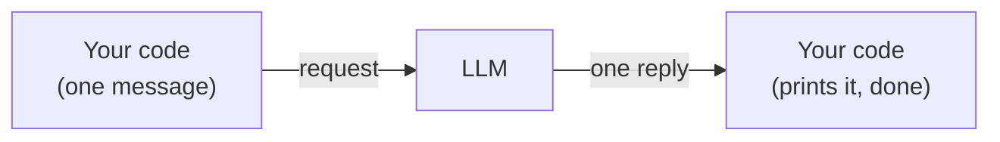

# Chapter 0. Life Without a Harness — One Call, One Answer

## What You'll Learn

- What a single LLM API call looks like, piece by piece
- Three things a single call can't do: remember, act, and keep working
- Why an "agent" isn't a special kind of model, but ordinary code wrapped around one

| You'll need | |
|---|---|
| Previous chapter | "Before You Begin": your virtual environment and Ollama setup |
| Code | `module00/module00_baseline.py` (87 lines) |
| Environment | The virtual environment activated, with `ollama serve` running |

---

## 0.1 The Starting Point

By the end of this book, you'll have an agent that plans, uses tools, recovers
from mistakes, and asks for permission before doing anything risky. But every
one of those features is built on the same foundation: one request to a
language model and one response back.

So before we build anything, let's look at that foundation on its own. What
can a model do when all you do is call it once? And just as important, what
*can't* it do?

---

## 0.2 The Big Idea: A Brilliant Expert on the Phone

Imagine you can call an expert who has read a staggering amount of text. Ask
a question and you'll get a fluent, confident answer. But this expert has
three quirks:

- **No memory.** Every call starts from zero. They don't remember you called
  five minutes ago.
- **No hands.** They can only talk. They can't use a calculator, open a file,
  or look anything up.
- **One answer per call.** They answer and hang up. If the job takes several
  steps, it's up to you to call back.

That's a language model behind an API. It's a function: **text goes in, text
comes out**, and nothing sticks around afterward.



Everything else in this book is code that works around these three quirks.
That code is the **harness**.

---

## 0.3 Walking Through the Code

The whole program is a configuration block plus one function.

### The configuration

```python
# module00/module00_baseline.py:39-47 (comments omitted)
BASE_URL = "http://localhost:11434/v1"
API_KEY = "ollama"
MODEL = "gemma4:e4b"

LLM_OPTIONS = {"reasoning_effort": "none"} if API_KEY == "ollama" else {}

client = OpenAI(base_url=BASE_URL, api_key=API_KEY)
```

- `BASE_URL` is where requests go. Here it's Ollama running on your own
  machine. Ollama speaks the same API "language" as OpenAI, which is why we
  can use the official `openai` package to talk to it.
- `API_KEY` is your password for the service. Ollama doesn't check it, but
  the `openai` package refuses to run without *something*, so we pass the
  placeholder `"ollama"`.
- `MODEL` picks which model answers.
- `LLM_OPTIONS` turns off the model's extended "thinking" mode when we're
  talking to Ollama, so answers come back faster and the output is easier to
  read. Not every provider understands this option, so we only send it to Ollama.

Every module in this book starts with these same lines. Switching to OpenAI
means changing these three constants and nothing else. (Appendix C walks
through it.)

### The call itself

```python
# module00/module00_baseline.py:60-70 (inside ask_llm_once)
response = client.chat.completions.create(
    model=MODEL,
    messages=[
        {"role": "user", "content": user_message},
    ],
    **LLM_OPTIONS,
)

reply = response.choices[0].message.content
print(f"RESPONSE: {reply}")
return reply
```

This is the most important code in the book. Every chapter that follows
calls this same function. Let's take it apart.

- **`messages`** is a list of dictionaries. Each one is a turn in a
  conversation, with a `role` (who's speaking) and `content` (what they said).
  Here there's exactly one: the user's question.
- **`role`** can be `"system"` (instructions for the model), `"user"` (you),
  `"assistant"` (the model), or `"tool"` (results from a tool, starting in
  Chapter 2).
- **`**LLM_OPTIONS`** unpacks the options dictionary into extra keyword
  arguments. When it's empty, it adds nothing.
- **`response.choices[0].message.content`** digs the text out of the
  response. The API can return several alternative answers ("choices"); we
  ask for one and take the first.

::: {.callout-note}
## Notice what's *not* here
There's no loop, no list that outlives the function, and no `tools=`
argument. The `messages` list is created inside the call and thrown away when
the function returns. Keep this in mind for Section 0.4.
:::

---

## 0.4 Running It

From the top-level folder of the repository:

```bash
python module00/module00_baseline.py
```

The script asks three questions, one call each. Here's what came back while
we were writing this chapter.

> Run on 2026-11-20 with Ollama `gemma4:e4b`, `openai` 3.57.0, Python 3.14.
> Model output can differ from run to run.

### Question 1: A plain question

```text
REQUEST: In one sentence, what is an 'agent harness'?
RESPONSE: An agent harness is a structured environment or framework designed to
simulate, test, or manage the interactions and decision-making processes of
autonomous agents in a controlled setting.
```

A fluent, confident, one-sentence answer, which is exactly what we asked for.
For many questions, a single call is all you need.

But read it closely. The model describes a *testing environment*. That's a
reasonable guess, but it's not what this book means. Here, a harness is **the
code you wrap around a model** to give it memory, tools, and a loop. The
model filled the gap with something plausible from its training data, and
nothing in its tone tells you it was guessing.

### Question 2: Arithmetic

```text
REQUEST: What is 384712 * 9931? Just compute it directly.
RESPONSE: To compute $384712 \times 9931$, we can use the fact that $9931 = 10000 - 69$.
...
$$= 2100000 + 560000 + 28000 + 4900 + 84$$
$$= 2,692,784$$
...
3,820,576,872
```

The correct answer is 3,820,574,872. The model is off by 2,000 because of a
single addition slip: those five numbers actually add up to 2,692,**9**84.
(Chapter 2 dissects this mistake in detail.) The model has no calculator, so
all it can do is imitate long multiplication in text, and it sounds equally
sure of itself whether it's right or wrong.

### Question 3: Memory

```text
REQUEST: What did I just ask you in my previous message?
RESPONSE: You just asked me: "What did I just ask you in my previous message?"
```

We asked two questions before this one, but the model has never heard of
them. Each call sends a brand-new `messages` list containing only the current
question, so as far as the model can tell, this *is* the whole conversation.
It answers with the only message it has seen.

### The three gaps

| What we saw | Why it happened | Fixed in |
|---|---|---|
| No memory of earlier questions | Nothing carries over between calls | Chapter 1 |
| One reply, then done | There's no loop to let it keep working | Chapter 1 |
| Confidently wrong arithmetic | The model can only talk; it can't run anything | Chapter 2 |

---

## 0.5 Common Problems

**`ModuleNotFoundError: No module named 'openai'`.**
Your virtual environment isn't active, or you installed the package somewhere
else. Activate the environment (`source .venv/bin/activate` on macOS/Linux)
and run `python -m pip install openai`.

**`Connection refused` or `APIConnectionError`.**
Ollama isn't running. Start it with `ollama serve` in another terminal.

**`model "gemma4:e4b" not found` (a 404 error).**
You haven't downloaded the model yet. Run `ollama pull gemma4:e4b`, then
check that it appears in `ollama list`.

**The first answer takes a long time.**
Ollama loads the model into memory on the first request, which can take a
while. Later requests are much faster.

**My answers are different from the book's.**
That's expected. Models don't give the exact same answer every time. What
should match is the *pattern*: a fine answer to Question 1, shaky arithmetic
in Question 2, and no memory in Question 3. (You might even get the
arithmetic right. Try it a few times.)

---

## 0.6 Try It Yourself

1. **Easy math** (easy) — Change Question 2 to `"What is 2 + 2?"`. Does the
   model get it right? Then try two eight-digit numbers. Does it ever admit
   it might be wrong?
2. **Same question, three times** (easy) — Call `ask_llm_once()` with the
   same question three times in a row. How much do the answers differ?
3. **Add a system message** (medium) — Put
   `{"role": "system", "content": "Answer in exactly five words."}` before
   the user message in `messages`. How does the answer change?
4. **Fake a memory** (medium) — Make Question 3 work. Build a `messages` list
   by hand that contains your first question, the model's answer (as an
   `"assistant"` message), and then "What did I just ask you?" What does that
   tell you about where "memory" really lives?

---

## 0.7 Recap

> **An agent isn't a different kind of model call. It's the same call,
> wrapped in code that adds memory, a loop, and tools. That code is the harness.**

- A call sends a `messages` list (each item has a `role` and `content`) and
  gets one reply back in `response.choices[0].message.content`.
- The model keeps nothing between calls. Each call sees only the `messages`
  you send with it.
- A fluent, confident answer isn't necessarily a correct one.

**In the next chapter**, we fix the first two gaps. We'll keep one `messages`
list alive across calls so the model can see the whole conversation, and wrap
the call in a loop so the model can keep working until it says it's done.

---

## Solutions and Hints

> In the final version, these move to Appendix D.

1. `2 + 2` is almost always right. With big numbers, the model usually gives
   a confident answer with no warning, even when it's wrong. It rarely says
   "I might be wrong" unless you ask it to.
2. The wording changes every time, and with harder questions the facts or
   numbers can change too. This is why later chapters never rely on the model
   giving the exact same output twice.
3. The answer gets squeezed into five words (or close to it). A system
   message is how you give the model standing instructions. Starting in
   Chapter 1, every module uses one.
4. Something like:
   ```python
   messages = [
       {"role": "user", "content": "What is the capital of France?"},
       {"role": "assistant", "content": "The capital of France is Paris."},
       {"role": "user", "content": "What did I just ask you?"},
   ]
   ```
   The model will now say you asked about the capital of France. The model
   didn't remember anything. *You* handed it the conversation. Memory lives
   in your code, not in the model, and that's the key idea of Chapter 1.
