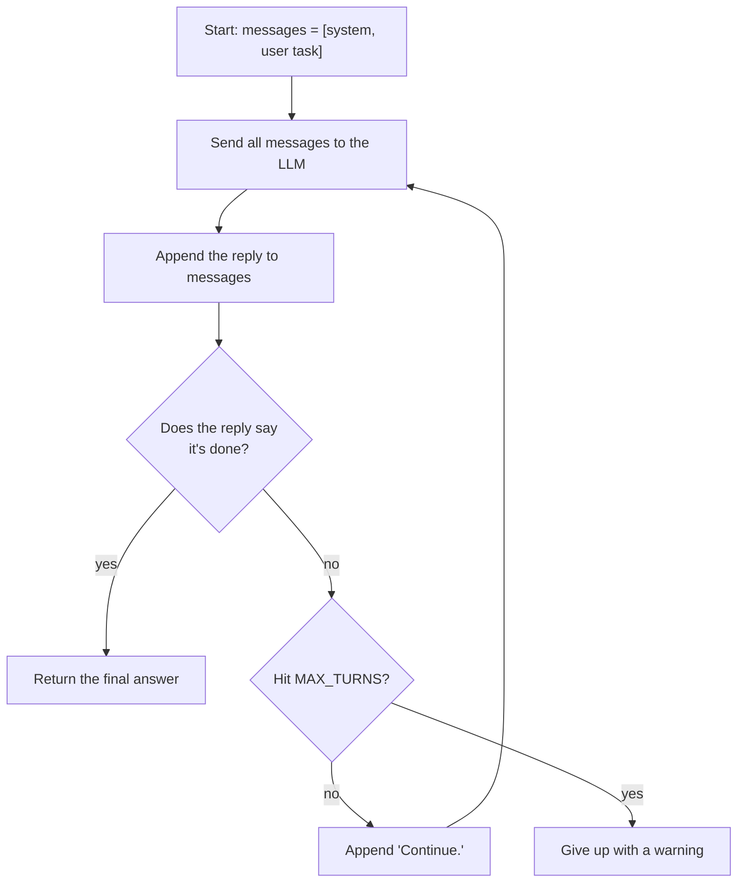

# Chapter 1. The Minimal Agent Loop — Keep Talking Until It's Done

## What You'll Learn

- Where an agent's "memory" really lives (hint: not in the model)
- The loop at the heart of every agent: send, append, check, repeat
- Why a stopping condition based on a magic word is fragile, and why every
  loop needs a hard limit anyway

| You'll need | |
|---|---|
| Previous chapter | Chapter 0: the `messages` list and a single API call |
| Code | `module01/module01_agent_loop.py` (154 lines) |
| Environment | The virtual environment activated, with `ollama serve` running |

---

## 1.1 The Problem: Every Call Starts From Zero

At the end of Chapter 0, we asked the model "What did I just ask you in my
previous message?" and it had no idea. It answered with the only message it
could see, the one we had just sent.

There was a second limit too. The model gave one answer and that was the end.
A real task, like "research this, then summarize it," takes several steps.
Something has to keep the conversation going until the job is finished.

This chapter solves both problems with about 40 lines of code.

---

## 1.2 The Big Idea: You Keep the Transcript

Remember the expert on the phone with no memory? Here's the trick: before
every call, **you read them the transcript of everything said so far**. They
still don't remember anything, but they don't need to, because the full
history is right in front of them.

We tried exactly this while writing the chapter. First we asked a question,
then sent a second request that included the first question, the model's
answer, *and* the new question:

```text
A1: The capital of France is **Paris**.
A2: You just asked me: "What is the capital of France?"
```

> Run on 2026-11-20 with Ollama `gemma4:e4b`, `openai` 3.57.0, Python 3.14.
> Model output can differ from run to run.

Same model, same kind of call as Chapter 0. The only difference is the list
we sent. **The model is still stateless. The memory is a Python list in your
program.**

Once you have the transcript, a loop is a small step further:



Two questions decide whether a loop like this works:

1. **How do we know the model is done?** In this chapter, we ask the model to
   write a special word, `TASK_COMPLETE`, when it's finished.
2. **What if it never says so?** We stop after `MAX_TURNS` no matter what.

You'll see shortly that question 1 is harder than it looks.

---

## 1.3 Walking Through the Code

### The magic word and the system prompt

```python
# module01/module01_agent_loop.py:57-69 (comments omitted)
DONE_MARKER = "TASK_COMPLETE"

SYSTEM_PROMPT = f"""You are a helpful assistant operating inside an agent loop.
You will be given a task and can respond over multiple turns to think it through.
When you are fully done and ready to give your final answer, start your message
with the exact marker "{DONE_MARKER}" followed by your final answer.
If you are not yet done, just respond normally and you will be prompted to continue.
"""

MAX_TURNS = 6
```

The system prompt is how your code and the model agree on a protocol. It
tells the model three things: it's inside a loop, it can take several turns,
and it should **start** its final message with `TASK_COMPLETE`. Keep that word
"start" in mind.

`MAX_TURNS` is the safety valve. However confused the model gets, the loop
runs at most six times.

### The transcript

```python
# module01/module01_agent_loop.py:89-92
messages = [
    {"role": "system", "content": SYSTEM_PROMPT},
    {"role": "user", "content": user_task},
]
```

In Chapter 0, `messages` was created inside each call and thrown away. Here
it's created **once, before the loop**, and it grows as the loop runs. This
list is the agent's entire memory.

### The loop

```python
# module01/module01_agent_loop.py:94-138 (comments and some prints omitted)
for turn in range(1, MAX_TURNS + 1):
    response = client.chat.completions.create(          # (a)
        model=MODEL,
        messages=messages,
        **LLM_OPTIONS,
    )
    assistant_reply = response.choices[0].message.content

    messages.append({"role": "assistant", "content": assistant_reply})  # (b)

    if DONE_MARKER in assistant_reply:                  # (c)
        before, after = assistant_reply.split(DONE_MARKER, 1)
        final_answer = after.strip() or before.strip()
        return final_answer

    messages.append({                                   # (d)
        "role": "user",
        "content": (
            f"Continue. If you are finished, remember to start your "
            f"reply with '{DONE_MARKER}'."
        ),
    })
```

- **(a) The call is exactly the same as Chapter 0.** Nothing about the API
  call is "agent-like." All the agent behavior comes from the code around it.
- **(b) Record what the model said.** Without this line, the next turn would
  have no idea what the model already wrote.
- **(c) Check for the magic word.** If it's there, the model is done, and we
  pull the final answer out of the reply. This takes two lines instead of
  one, for a reason that deserves its own section (1.4).
- **(d) Nudge the model to keep going.** If it isn't done, we add a short
  user message and loop again. This message brings new information into the
  conversation to drive the next step. In Chapter 2, tool results will play
  this same role.

### The safety net

```python
# module01/module01_agent_loop.py:143-144
print("\n[WARNING] Max turns reached without a done marker.")
return "(Agent did not finish within the turn limit.)"
```

If the loop runs `MAX_TURNS` times without finding the marker, we stop
anyway. It's the least interesting code in the file and one of the most
important. A model that loops forever is a model that bills you forever.

---

## 1.4 Why Two Lines? The Model Doesn't Follow the Format

The system prompt tells the model to **start** its final message with
`TASK_COMPLETE`, followed by the answer. So the obvious way to pull out the
answer is to take everything after the marker:

```python
final_answer = assistant_reply.split(DONE_MARKER, 1)[1].strip()
```

An earlier version of this module did exactly that. Here's what it printed
when we ran it:

```text
[STEP 1] LLM responded:
---
Here are three short bullet points explaining why agent loops need a stopping condition:

*   **Prevent Infinite Loops:** Without a defined end, the loop will continue executing indefinitely, ...
*   **Ensure Convergence/Goal Achievement:** A condition is needed to signal when ...
*   **Manage Computational Budget:** The stopping condition acts as a safeguard, ...

TASK_COMPLETE
---

[STEP 1] Done marker found. Ending loop.

############################################################
FINAL ANSWER:

############################################################
```

> Run on 2026-11-20 with Ollama `gemma4:e4b`, `openai` 3.57.0, Python 3.14.
> Model output can differ from run to run.

The model wrote a good answer, and then **the final answer came back empty.**
It happened on every run we tried.

The model put the marker at the **end** of its reply, not the start. Trace
what the one-line version does with that:

```python
reply = "Here are three short bullet points...\n\nTASK_COMPLETE"

reply.split("TASK_COMPLETE", 1)
# → ["Here are three short bullet points...\n\n", ""]
#     index [0]: everything before the marker    [1]: everything after it

reply.split("TASK_COMPLETE", 1)[1].strip()
# → ""
```

The code assumed the answer comes after the marker. The model put it before.
Nothing crashed and nothing raised an error. The check passed, the loop ended
"successfully," and the answer simply vanished.

That's what makes text protocols dangerous. Your code and the model agree on
a format in plain English, and **the model follows that format only some of
the time.** When it drifts, the program often doesn't fail loudly. It quietly
does the wrong thing.

The fix is to accept both placements:

```python
# module01/module01_agent_loop.py:123-124
before, after = assistant_reply.split(DONE_MARKER, 1)
final_answer = after.strip() or before.strip()
```

`split(..., 1)` always returns two pieces, so we can unpack them into
`before` and `after`. Then `or` does the choosing: an empty string counts as
false in Python, so if `after` is empty, we use `before` instead.

This is a pattern you'll use constantly when your code reads model output:
**decide what you'll accept, and parse defensively.** Asking nicely in the
prompt is not enough.

---

## 1.5 Running It

```bash
python module01/module01_agent_loop.py
```

With the fix in place, here's the actual output:

```text
USER TASK: Explain, in exactly 3 short bullet points, why agent loops need a stopping condition.

============================================================
[STEP 1] Sending 2 messages to the LLM...
============================================================
[STEP 1] LLM responded:
---
Here are three short bullet points explaining why agent loops need a stopping condition:

*   **Prevent Infinite Loops:** Without a defined endpoint, the agent could run indefinitely, consuming excessive computational resources without reaching any goal.
*   **Ensure Goal Attainment:** A stopping condition signals when the desired objective has been met, allowing the process to conclude successfully rather than continuing unnecessarily.
*   **Maintain System Stability:** It provides a necessary control mechanism to prevent resource exhaustion or erroneous continuous operation, ensuring predictable and manageable behavior.

TASK_COMPLETE
---

[STEP 1] Done marker found. Ending loop.

############################################################
FINAL ANSWER:
Here are three short bullet points explaining why agent loops need a stopping condition:

*   **Prevent Infinite Loops:** Without a defined endpoint, the agent could run indefinitely, consuming excessive computational resources without reaching any goal.
*   **Ensure Goal Attainment:** A stopping condition signals when the desired objective has been met, allowing the process to conclude successfully rather than continuing unnecessarily.
*   **Maintain System Stability:** It provides a necessary control mechanism to prevent resource exhaustion or erroneous continuous operation, ensuring predictable and manageable behavior.
############################################################
```

The model still put the marker at the end (it did in all three runs), but
now the answer comes through.

### Watching the loop actually loop

The default task finishes in one step, so you never see the "Continue" path.
To watch it, we gave the model a task that forces several turns: write a
three-line poem, one line per reply. We ran it four times. Here's the first run:

```text
[STEP 1] Sending 2 messages to the LLM...
[STEP 1] LLM responded:
---
One cycle turns, a constant beat,
---
[STEP 1] No done marker yet. Continuing loop...
[STEP 2] Sending 4 messages to the LLM...
[STEP 2] LLM responded:
---
Through repetition, paths complete.
---
[STEP 2] No done marker yet. Continuing loop...
[STEP 3] Sending 6 messages to the LLM...
[STEP 3] LLM responded:
---
Repeating till the break is sweet.
TASK_COMPLETE
---
[STEP 3] Done marker found. Ending loop.
=> RETURNED: 'Repeating till the break is sweet.'
```

Watch the message count: 2 → 4 → 6. Each turn adds two messages, the model's
reply and our "Continue" nudge. By STEP 3, the model sees this:

| # | role | content |
|---|---|---|
| 1 | `system` | "You are a helpful assistant operating inside an agent loop..." |
| 2 | `user` | "Write a three-line poem about loops, one line per reply..." |
| 3 | `assistant` | "One cycle turns, a constant beat," |
| 4 | `user` | "Continue. If you are finished, remember to start your reply with 'TASK_COMPLETE'." |
| 5 | `assistant` | "Through repetition, paths complete." |
| 6 | `user` | "Continue. If you are finished, ..." |

The model writes a line that rhymes with the earlier ones, which is proof
that it's reading the transcript. And the loop stops by itself when the model
says it's done. That part works.

But look at what came back: only the **last line** of the poem. The first two
lines are in *earlier* messages, and our code only looks at the reply that
contains the marker.

The other three runs were just as instructive:

- One run followed the instructions perfectly, putting `TASK_COMPLETE` at the
  *start* of its third reply, before the last line. The `after` branch handled it.
- One run ignored "one line per reply," wrote all three lines at once, and
  then replied with nothing but `TASK_COMPLETE` on the next turn. Both
  `before` and `after` were empty, so the function returned `''`.
- One run behaved like the run above.

Same code, same prompt, three different shapes of reply. No amount of clever
parsing makes a text marker fully reliable, because the problem isn't the
parsing. **"The final answer" is something the model expresses in free text,
and free text can take any shape.** Chapter 2 replaces the marker with a
signal that has a fixed structure.

---

## 1.6 Common Problems

**The final answer is empty.**
The model probably replied with nothing but `TASK_COMPLETE`, after putting
its real answer in an earlier message. Print `messages` (Exercise 2) to check.
Exercise 3 explores a fix.

**The final answer is only part of what the model wrote.**
In a multi-turn task, the answer is spread across several messages, and the
code returns only the one with the marker. See the poem run in Section 1.5.

**I get `[WARNING] Max turns reached without a done marker.`**
The model never wrote the marker. Either the task really needed more than
six turns, or the model forgot the protocol. Print `messages` at the end to
see what it was writing.

**The loop stopped too early.**
The check is `if DONE_MARKER in assistant_reply`, so the marker counts
*anywhere* in the reply, even if the model is just talking about it ("I'll
write TASK_COMPLETE when I'm done"). Text markers can't tell the difference
between *using* a word and *mentioning* it.

**Every turn is slower than the last.**
Each turn sends the whole transcript again, so requests keep getting bigger.
For a handful of turns, that's fine. For long conversations, it becomes a
real cost. That's the subject of Chapter 4.

---

## 1.7 Try It Yourself

1. **Pull the safety valve** (easy) — Set `MAX_TURNS = 1` and run the
   three-line-poem task from Section 1.5. What does the program return?
2. **Print the transcript** (easy) — At the end of `run_agent_loop()`, just
   before each `return`, add `for m in messages: print(m["role"], "→", m["content"][:60])`.
   Run it again and compare it with the table in Section 1.5.
3. **Break it, then fix it better** (medium) — First, change line 124 back to
   `final_answer = after.strip()` and run the default task. Do you get the
   empty answer from Section 1.4? Then restore the line and handle the last
   remaining case: when the reply is *only* the marker, return the previous
   assistant message instead.
4. **Rename the marker** (medium) — Change `DONE_MARKER` to `"ALL_DONE"`. What
   else had to change? (Hint: look at how the system prompt is built.) What
   would happen if the prompt and the code disagreed?
5. **Ask for the impossible** (challenge) — Make a system prompt that tells
   the model to never write the marker. Watch every safety mechanism in the
   loop kick in.

---

## 1.8 Recap

> **The model has no memory. The agent's memory is the `messages` list your
> code keeps and resends, and the agent's "life" is the loop around the call.**

- The loop: send all messages → append the reply → check if done → if not,
  nudge and repeat.
- A text marker is the simplest possible stopping signal, and it's fragile.
  The model follows the format only some of the time, so parse its output
  defensively, and expect some failures to be silent.
- Always cap the loop with `MAX_TURNS`, no matter how good your stopping
  signal is.

**In the next chapter**, we replace the magic word with something the model
can't misplace: a structured signal from the API itself. We'll also give the
model its first tool, so it can finally *do* something instead of only talking.

---

## Solutions and Hints

> In the final version, these move to Appendix D.

1. After one turn, there's no marker, so the loop ends with the warning and
   returns `"(Agent did not finish within the turn limit.)"`. The safety valve
   works even when everything else goes wrong.
2. You should see `system`, `user`, then alternating `assistant` and `user`
   ("Continue...") entries: two new messages per turn, matching the 2 → 4 → 6
   counts in the log.
3. With only `after.strip()`, the default task comes back empty whenever the
   model puts the marker at the end, which in our runs was every time. For
   the second part, one approach:
   ```python
   before, after = assistant_reply.split(DONE_MARKER, 1)
   final_answer = after.strip() or before.strip()
   if not final_answer:
       earlier = [m["content"] for m in messages[:-1] if m["role"] == "assistant"]
       final_answer = earlier[-1].strip() if earlier else ""
   ```
   `messages[:-1]` skips the reply we just appended (the bare marker). Notice
   how much code it now takes to answer "what did the model mean?" That's
   the cost of a text protocol, and the reason Chapter 2 moves away from it.
4. Thanks to the f-string, the system prompt picks up the new marker
   automatically, so nothing else has to change. If the prompt said
   `TASK_COMPLETE` while the code checked for `ALL_DONE`, the model would
   never "finish," and you'd hit `MAX_TURNS` every time.
5. The model never writes the marker, so after six turns you hit the
   `MAX_TURNS` warning. Watch the message count grow by two every step.
   Without `MAX_TURNS`, this would run (and bill you) forever.
