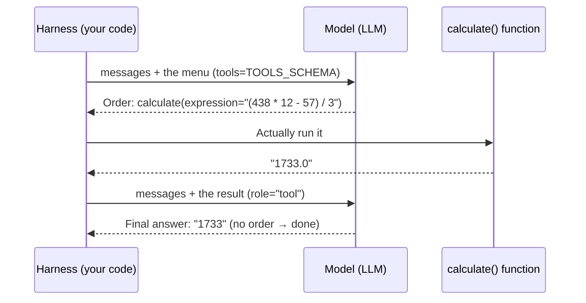

# Chapter 2. Your First Tool — Handing the Model a Calculator

## What You'll Learn

- The model never runs code itself. It **asks your code to run something**.
- The three pieces that make up a tool: **a function, a schema, and a registry**
- How Chapter 1's loop turns into "if the model calls a tool, keep going; if not, we're done"

| You'll need | |
|---|---|
| Previous chapter | Chapter 1 (The Minimal Agent Loop): the `messages` list and the `for` loop |
| Code | `module02/module02_first_tool.py` (183 lines) |
| Environment | The virtual environment from "Before You Begin," with `ollama serve` running |

---

## 2.1 The Problem: Confidently Wrong

Back in Chapter 0, we asked the model to do a big multiplication. Here's what
came back when we ran it again while writing this chapter:

```text
REQUEST: What is 384712 * 9931? Just compute it directly.
RESPONSE: To compute $384712 \times 9931$, we can use the fact that $9931 = 10000 - 69$.
...
First, $384712 \times 7$:
$$= 2100000 + 560000 + 28000 + 4900 + 84$$
$$= 2,692,784$$
...
$$3,847,120,000 - 26,543,128$$ ... 3,820,576,872
```

> Run on 2026-11-20 with Ollama `gemma4:e4b`, `openai` 3.57.0, Python 3.14.
> Model output can differ from run to run.

The work looks convincing. The model even uses the clever trick of rewriting
9931 as `10000 - 69`. But the correct answer is **3,820,574,872**, so the
model is **off by 2,000**. Where did it slip? Add up
`2100000 + 560000 + 28000 + 4900 + 84` and you get 2,692,**9**84. The model
wrote 2,692,**7**84. One addition error, carried all the way to the end.

When we asked the same question but told it to "give me just the final number,"
it once answered `382039032`, which doesn't even have the right number of digits.

::: {.callout-important}
## This isn't "models can't do math"
For something like "(438 × 12) − 57, divided by 3," the model usually gets it
right without help. We asked three times while writing this chapter and got 1733
every time. The real problem is that **you can't tell when it will be wrong**,
and **it sounds just as confident when it is**. In a program that relies on the
answer, that's a dealbreaker.
:::

The fix is simple: let a calculator do the calculating. The catch is that the
model has no hands. So your code is going to be its hands.

---

## 2.2 The Big Idea: The Model Writes the Order, the Harness Cooks It

Picture a restaurant.

- **The customer (the model)** reads the menu and writes down an order. They
  never walk into the kitchen.
- **The menu (the tool schema)** lists the dishes you can order and the options
  for each one.
- **The kitchen (the harness, meaning your code)** takes the order ticket,
  actually cooks the food, and sends it out.

Tool calling works exactly like this:



Two things in this diagram are worth remembering:

1. **The model doesn't execute code.** It returns a structured request that
   says "please call this function with these arguments," and your code always
   does the running. That means *you* decide what runs and whether it's allowed
   to. (This is where Chapter 9's guardrails begin.)
2. **No order means we're done.** In Chapter 1, we asked the model to write
   the text `TASK_COMPLETE` and then searched its reply for that string. Now,
   if a response comes back *without* a tool call, we treat it as the final
   answer. There's no magic word for the model to forget, so this is much
   more reliable.

---

## 2.3 Walking Through the Code, Part 1: The Three Pieces of a Tool

Adding a tool takes three things:

| Piece | Restaurant analogy | In the code |
|---|---|---|
| Function | The dish the kitchen actually cooks | `calculate()` |
| Schema | The menu | `TOOLS_SCHEMA` |
| Registry | The chart that says which cook handles which dish | `TOOL_REGISTRY` |

### Piece 1. The function — the code that does the work

```python
# module02/module02_first_tool.py:49-67 (some comments omitted)
def calculate(expression: str) -> str:
    try:
        result = eval(expression, {"__builtins__": {}}, {})
        return str(result)
    except Exception as e:
        return f"ERROR: could not evaluate '{expression}': {e}"
```

It's an ordinary Python function. Two details are worth a closer look:

- **It returns a string.** Whatever we send back to the model ends up as text.
- **When it fails, it returns an error message instead of raising an
  exception.** That way the model can read "oh, that expression was invalid"
  and try again. If the program crashed instead, the model would never even
  find out what happened.

::: {.callout-warning}
## `eval()` is for teaching only
`eval()` runs a string as Python code. Emptying out `__builtins__` blocks
dangerous functions like `open()`, but it's still **not safe for untrusted
input**. We use it here only because it's the shortest way to show how tool
calling flows. A real service should use a library that parses math
expressions and nothing else. Chapter 14, Section 14.3, comes back to this.
:::

### Piece 2. The schema — the menu the model reads

```python
# module02/module02_first_tool.py:75-93
TOOLS_SCHEMA = [
    {
        "type": "function",
        "function": {
            "name": "calculate",
            "description": "Evaluate a basic arithmetic expression and return the numeric result.",
            "parameters": {
                "type": "object",
                "properties": {
                    "expression": {
                        "type": "string",
                        "description": "A Python-style arithmetic expression, e.g. '2 + 2' or '(5*3)/2'.",
                    }
                },
                "required": ["expression"],
            },
        },
    }
]
```

The model can't see your Python code. **This description is everything it
knows** about the tool.

- `name`: what the model writes on the order ticket. It has to match the key
  in the registry exactly.
- `description`: what the model uses to decide when this tool is useful.
  Write it as **documentation for the model, not for a human**.
- `parameters`: the shape of the arguments, in [JSON Schema](https://json-schema.org/)
  format. This one says "there must be exactly one string called `expression`."

### Piece 3. The registry — the chart that connects names to functions

```python
# module02/module02_first_tool.py:98-100
TOOL_REGISTRY = {
    "calculate": calculate,
}
```

What the model sends back is the **string** `"calculate"`. To get from that
string to the real function, you need a lookup table. Right now it's a
one-line dictionary. In Chapter 3, when the number of tools grows, we'll
automate this part with a decorator.

::: {.callout-tip}
## Stop and think
With this setup, adding one more tool means editing **three places**: the
function, the schema, and the registry. What happens if you forget one?
That annoyance is where Chapter 3 begins.
:::

---

## 2.4 Walking Through the Code, Part 2: How the Loop Changed

The loop's skeleton is the same as in Chapter 1. Three things changed.

### Change 1. Send the menu along

```python
# module02/module02_first_tool.py:117-123
response = client.chat.completions.create(
    model=MODEL,
    messages=messages,
    tools=TOOLS_SCHEMA,      # ← the one line Chapter 1 didn't have
    **LLM_OPTIONS,
)
message = response.choices[0].message
```

The single line `tools=TOOLS_SCHEMA` tells the model "these are the tools you
can use." Without it, the model doesn't even know the tool exists.

### Change 2. If there's an order, run it and send back the result

```python
# module02/module02_first_tool.py:126-160 (print statements omitted)
if message.tool_calls:
    messages.append(message)                              # (a) record the order first

    for tool_call in message.tool_calls:
        tool_name = tool_call.function.name               # "calculate"
        tool_args = json.loads(tool_call.function.arguments)  # (b) string → dict

        tool_fn = TOOL_REGISTRY.get(tool_name)            # (c) look it up
        if tool_fn is None:
            tool_result = f"ERROR: unknown tool '{tool_name}'"
        else:
            tool_result = tool_fn(**tool_args)            # (d) actually run it

        messages.append({                                 # (e) record the result
            "role": "tool",
            "tool_call_id": tool_call.id,
            "content": str(tool_result),
        })

    continue                                              # (f) back to the model
```

Let's go line by line.

- **(a) Order matters.** First add the model's order (the assistant message
  that holds `tool_calls`) to `messages`, and only *then* add the results. The
  API expects "order, then result." Swap them and the API returns an error.
- **(b) Arguments arrive as a JSON string.** They look like
  `'{"expression":"(438 * 12 - 57) / 3"}'`, so `json.loads()` turns them into
  a dictionary.
- **(c) Be ready for unknown tools.** The model might invent a name that isn't
  on the menu. Even then, the program doesn't stop; it sends back an error
  string as the result.
- **(d) `**tool_args`** unpacks a dictionary into keyword arguments.
  `calculate(**{"expression": "1+1"})` is the same as `calculate(expression="1+1")`.
- **(e) `tool_call_id` pairs results with orders.** The model can call several
  tools at once (Chapter 8), so the id tells it which order this result belongs to.
- **(f) `continue`** jumps back to the top of the loop so the model, having
  seen the result, can decide what to do next: call another tool or give a
  final answer.

::: {.callout-note}
## Can `messages` hold an object instead of a dict?
The `message` added in (a) is an object created by the SDK, while the one
added in (e) is a plain dictionary. The `openai` SDK accepts both, so this
works. Just keep in mind that if you later want to save `messages` to a file
(Chapters 5 and 10), you'll need to convert everything to dictionaries.
:::

### Change 3. The stopping condition

```python
# module02/module02_first_tool.py:165-166
print(f"[STEP {turn}] LLM gave a final answer (no tool call).")
return message.content
```

If we didn't enter `if message.tool_calls:` (in other words, there was no
order), that's the final answer. Notice that Chapter 1's `DONE_MARKER` is
gone. The `MAX_TURNS` safety valve is still there, though, in case the model
keeps calling tools and never wraps up.

---

## 2.5 Running It

Run this from the top-level folder of the repository:

```bash
python module02/module02_first_tool.py
```

Here's the actual output we got while writing this chapter:

```text
USER TASK: What is (438 * 12) - 57, divided by 3? Give me just the final number.

============================================================
[STEP 1] Sending 2 messages to the LLM (tools enabled)...
============================================================
[STEP 1] LLM requested 1 tool call(s).
  -> Calling tool 'calculate' with args: {'expression': '(438 * 12 - 57) / 3'}
  <- Tool result: 1733.0

============================================================
[STEP 2] Sending 4 messages to the LLM (tools enabled)...
============================================================
[STEP 2] LLM gave a final answer (no tool call).

############################################################
FINAL ANSWER:
1733
############################################################
```

> Run on 2026-11-20 with Ollama `gemma4:e4b`, `openai` 3.57.0. We ran it three
> times and got the same flow each time.

### How to read this output

**STEP 1 — "Sending 2 messages"**: the system prompt and the user's question.

**The order the model sent back**: the log only shows a summary, but if you
unpack the actual response object, it looks like this:

```json
{
  "content": "",
  "role": "assistant",
  "tool_calls": [
    {
      "id": "call_2lxigzyv",
      "type": "function",
      "function": {
        "name": "calculate",
        "arguments": "{\"expression\":\"(438 * 12 - 57) / 3\"}"
      }
    }
  ]
}
```

The `content` (what the model *says*) is empty, and there's only `tool_calls`
(the order). Notice that `arguments` is a JSON **string**. That's why step (b)
in Section 2.4 needed `json.loads()`. The response's `finish_reason` was
`"tool_calls"`, meaning "I stopped talking so I could call a tool."

Here's something interesting: the user asked for "(438 × 12) − 57, divided by
3," and the model folded that into **a single expression** and asked for it in
one call. How to split up the work is also the model's decision.

**STEP 2 — "Sending 4 messages"**: why four? Here's what `messages` holds now:

| # | role | content |
|---|---|---|
| 1 | `system` | "You are a helpful assistant with access to tools..." |
| 2 | `user` | "What is (438 * 12) - 57, divided by 3?..." |
| 3 | `assistant` | The order: `calculate("(438 * 12 - 57) / 3")` |
| 4 | `tool` | `"1733.0"` (`tool_call_id="call_2lxigzyv"`) |

After reading message 4, the model decided it didn't need any more tools and
replied with just `1733`, no order attached. So the loop ended. Also notice
that the tool returned `1733.0` but the final answer is `1733`. The model
cleaned up the result for the human reading it.

---

## 2.6 Common Problems

**I get `Connection refused` or `APIConnectionError`.**
The Ollama server isn't running. Run `ollama serve` in another terminal, then
check that `gemma4:e4b` shows up in `ollama list`.

**The model answers right away without calling the tool.**
Check these in order:
1. Does the model support tool calling? Not all of them do. In Ollama, run
   `ollama show <model-name>` and look for `tools` under Capabilities.
2. Did you leave out `tools=TOOLS_SCHEMA`?
3. The problem may be easy enough that the model decided to do it in its head.
   That's not a bug; it's the model's choice. You can make the system prompt
   more forceful, e.g. "always use the tool for arithmetic."

**The model *says* it will use the calculator, then just stops.**
This happens when you don't send `tools=` but the system prompt still says
"use the calculate tool." When we asked the same question without `tools=`,
the model replied, "I will use the calculate tool to solve this
step-by-step..." and then pretended to. A model can *say* anything; the only
things that actually run are the things your harness runs.

**The program crashes with `json.decoder.JSONDecodeError` or `TypeError`.**
Small models sometimes send broken JSON or use the wrong argument name, like
`expr`. This chapter's code doesn't wrap `json.loads()` (line 136) or
`tool_fn(**tool_args)` (line 145) in a `try`, so either mistake stops the
whole loop. We left that weakness in on purpose; Chapter 3 fixes it.

**My output looks a little different from the book.**
That's normal. The `tool_call_id` changes every run, and the way the model
splits up the expression or phrases its final answer (`1733`, `1733.0`, a full
sentence) can vary. What matters is the **flow**: tool call → result → final answer.

---

## 2.7 Try It Yourself

1. **Go big** (easy) — Change `task` at the bottom of the file to
   `"What is 384712 * 9931?"` and run it. Does the model get right the problem
   it got wrong in Section 2.1?
2. **Take away the menu** (easy) — Delete the `tools=TOOLS_SCHEMA` line and
   run exercise 1 again. What changes?
3. **The power of a description** (medium) — Change the schema's
   `description` to `"Does something."` Does the model still use the tool?
   Run it a few times and compare.
4. **One step at a time** (medium) — Ask for step-by-step calls, e.g.
   `"Compute 438 * 12. Then subtract 57 from that result and divide by 3. Use a
   separate tool call for each step."` How many STEPs do you see, and how does
   the number of `messages` grow?
5. **Add a tool** (challenge) — Add your own `count_chars(text: str)` tool that
   counts the characters in a string. Count how many places you had to edit.

---

## 2.8 Recap

> **The model doesn't run code. It only asks for code to be run. Running it and
> sending back the result is the harness's job.**

- A tool = a **function** (the real work) + a **schema** (the manual the model
  reads) + a **registry** (name → function)
- The loop rule: if there are `tool_calls`, run them, append the results as
  `role="tool"`, and keep going; if there aren't, treat the reply as the final
  answer and stop
- Record the order (assistant) before the result (tool), and pair them up with
  `tool_call_id`

**In the next chapter**, we grow to three tools. Right away, two problems get
real: having to edit three places for every tool, and (from Section 2.6) one
bad argument crashing the whole program. Chapter 3 shows how to register tools
in one place with a decorator, and how to turn failures into error messages the
model can read.

---

## Solutions and Hints

Solutions to this chapter's exercises are in [Appendix D](../appendices/appendix-d-solutions.md#chapter-2-your-first-tool).
