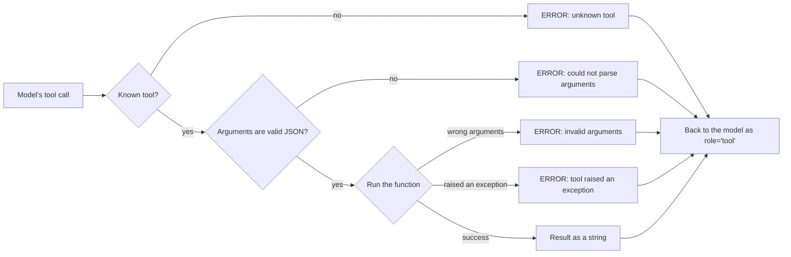

# Chapter 3. The Tool Registry — More Tools, Fewer Crashes

## What You'll Learn

- How a **decorator** lets you register a tool in one place instead of three
- The three ways a tool call goes wrong, and how to turn each one into a
  message the model can read instead of a crash
- What happens when the model has more than one tool to choose from

| You'll need | |
|---|---|
| Previous chapter | Chapter 2: the function, schema, and registry, and the tool-calling loop |
| Code | `module03/module03_tool_registry.py` (242 lines) |
| Environment | The virtual environment activated, with `ollama serve` running |

---

## 3.1 The Problem: Two Cracks in Chapter 2

Chapter 2 left us with two problems, and both get worse as you add tools.

**Crack 1: Every tool lives in three places.** To add a tool, you write the
function, add its schema to `TOOLS_SCHEMA`, and add it to `TOOL_REGISTRY`.
Forget the schema and the model never learns the tool exists. Forget the
registry and every call fails with "unknown tool." With one tool, that's
manageable. With twenty, something will slip.

**Crack 2: One bad argument crashes everything.** Chapter 2's loop runs
`tool_fn(**tool_args)` with no protection. Suppose a small model sends `expr`
instead of `expression`. Here's what Python does with that:

```python
>>> calculate(**{"expr": "2 + 2"})
TypeError: calculate() got an unexpected keyword argument 'expr'
```

That exception isn't caught, so it travels up and stops the whole program.
The model made a small, fixable mistake, and instead of getting a chance to
fix it, it never hears about it at all.

---

## 3.2 The Big Idea: Sign Up Once, Never Burn Down the Kitchen

Back to the restaurant from Chapter 2. This chapter makes two changes to how
the kitchen runs.

**One sign-up sheet.** Instead of updating the menu and the cook-assignment
chart separately, every new dish gets added by filling out a single card that
says what the dish is *and* who cooks it. In code, that card is a
**decorator** that sits right on top of the tool's function.

**Problems go back out as notes.** When an order can't be filled ("we're out
of salmon," "there's no such dish," "this order is illegible"), the kitchen
doesn't catch fire. It sends a note back to the table, and the customer
decides what to do next. In code, every failure becomes an `"ERROR: ..."`
string that goes back to the model as the tool's result.



Every path ends in the same place: a string that goes back to the model.
There's no path that ends in a crash.

---

## 3.3 A Quick Detour: What Is a Decorator?

If you've never written a decorator, here's all you need for this chapter.

A decorator is a function that **receives another function**, does something
with it, and hands it back. The `@` line is shorthand:

```python
@shout
def greet():
    return "hi"

# ...means exactly the same as:

def greet():
    return "hi"
greet = shout(greet)
```

Here's a decorator that doesn't change the function at all. It just writes it
down in a dictionary:

```python
REGISTRY = {}

def register(fn):
    REGISTRY[fn.__name__] = fn   # fn.__name__ is the function's name as a string
    return fn                    # hand back the original, unchanged

@register
def greet():
    return "hi"

print(REGISTRY)   # {'greet': <function greet at 0x...>}
```

Notice *when* this happens: the moment Python reads the `def`, before you ever
call `greet()`. Defining the function is enough to register it.

Our tool decorator also needs extra information, such as a description and a
parameter list. To pass arguments to a decorator, you add one more layer: a
function that takes the arguments and **returns** a decorator. That's called
a *decorator factory*, and it's what `@tool(...)` is.

---

## 3.4 Walking Through the Code, Part 1: The Registry

### The decorator factory

```python
# module03/module03_tool_registry.py:53-80 (docstring omitted)
TOOL_REGISTRY = {}   # name -> python function
TOOLS_SCHEMA = []    # name -> JSON schema description sent to the LLM


def tool(description: str, parameters: dict, required: list):
    def decorator(fn):
        TOOL_REGISTRY[fn.__name__] = fn
        TOOLS_SCHEMA.append({
            "type": "function",
            "function": {
                "name": fn.__name__,
                "description": description,
                "parameters": {
                    "type": "object",
                    "properties": parameters,
                    "required": required,
                },
            },
        })
        return fn
    return decorator
```

Read it from the outside in:

1. `tool(description, parameters, required)` takes the menu details and
   returns `decorator`.
2. `decorator(fn)` receives the tool's function and does both jobs from
   Chapter 2 in one place: it adds the function to `TOOL_REGISTRY` and
   appends a schema to `TOOLS_SCHEMA`.
3. It returns `fn` unchanged, so you can still call the function normally.

One detail removes a whole category of bugs: the tool's name comes from
`fn.__name__`. The registry key and the schema's `name` are generated from
the same source, so they can never disagree.

### Three tools

```python
# module03/module03_tool_registry.py:87-97
@tool(
    description="Evaluate a basic arithmetic expression and return the numeric result.",
    parameters={
        "expression": {"type": "string", "description": "e.g. '2 + 2' or '(5*3)/2'"}
    },
    required=["expression"],
)
def calculate(expression: str) -> str:
    """Same as Module 2's calculator tool."""
    result = eval(expression, {"__builtins__": {}}, {})
    return str(result)
```

Compare this with Chapter 2, where the same tool took about 50 lines spread
across three places.
Everything about the tool now sits in one block.

Look closely and you'll notice something missing: Chapter 2's `calculate` had
its own `try`/`except`, and this one doesn't. That's not an oversight. Error
handling has moved out of the individual tools and into one shared function
(Section 3.5), so each new tool doesn't need to remember to handle its own
failures.

The other two tools follow the same pattern:

- **`search_web(query)`** is a **stub**. It doesn't search anything; it
  returns a canned string that says `[STUB RESULT] Pretend web search results
  for: '...'`. That way you can watch the model choose between tools without
  signing up for a search API. Section 3.7 shows a surprising side effect.
- **`read_file(path)`** is real. It opens a file on your disk and returns its
  contents. If the file doesn't exist, `open()` raises an exception, and the
  shared error handling has to catch it.

```python
# module03/module03_tool_registry.py:127-134 (docstring omitted)
def read_file(path: str) -> str:
    with open(path, "r", encoding="utf-8") as f:
        return f.read()
```

::: {.callout-warning}
## A file-reading tool is a real permission
`read_file` can read any file your user account can read, wherever the model
points it. That's fine for learning on your own machine, but it's exactly the
kind of power Chapter 9 (guardrails) and Chapter 14 (sandboxing) teach you to
limit.
:::

---

## 3.5 Walking Through the Code, Part 2: One Function That Never Crashes

All tool calls now go through `execute_tool_call()`. Its promise is simple:
**it always returns a string and never raises.**

```python
# module03/module03_tool_registry.py:140-176 (docstring and comments omitted)
def execute_tool_call(tool_call) -> str:
    tool_name = tool_call.function.name

    tool_fn = TOOL_REGISTRY.get(tool_name)                                   # (1)
    if tool_fn is None:
        return f"ERROR: unknown tool '{tool_name}'. Available tools: {list(TOOL_REGISTRY.keys())}"

    try:                                                                     # (2)
        tool_args = json.loads(tool_call.function.arguments)
    except json.JSONDecodeError as e:
        return f"ERROR: could not parse arguments as JSON: {e}"

    try:
        return str(tool_fn(**tool_args))
    except TypeError as e:                                                   # (3)
        return f"ERROR: invalid arguments for '{tool_name}': {e}"
    except Exception as e:                                                   # (4)
        return f"ERROR: tool '{tool_name}' raised an exception: {e}"
```

There are three failure modes, checked in the order they can happen:

- **(1) Unknown tool.** The model asked for a tool that isn't registered.
  Notice the error message lists the tools that *do* exist. That's not just
  for you; it gives the model what it needs to correct itself on the next turn.
- **(2) Unreadable arguments.** The arguments aren't valid JSON.
- **(3) Wrong arguments.** The JSON parsed, but it doesn't fit the function:
  a misspelled name, a missing required argument, or an extra one. Python
  raises `TypeError` when a call doesn't match a function's signature, so
  that's what we catch.
- **(4) The tool itself failed.** The call was fine, but something went
  wrong inside the tool, like a missing file or division by zero.

### Try every failure without a model

You don't need the model to watch this function work. You can hand it fake
tool calls. Save this as `try_failures.py` in the repository's top-level
folder and run it:

```python
import sys
from types import SimpleNamespace as NS

sys.path.insert(0, "module03")
from module03_tool_registry import execute_tool_call

def fake_call(name, arguments):
    return NS(function=NS(name=name, arguments=arguments))

cases = [
    ("calculate",   '{"expression": "2 + 2"}'),   # works
    ("get_weather", '{"city": "Boston"}'),        # (1) unknown tool
    ("calculate",   '{"expression": "2 + 2"'),    # (2) broken JSON
    ("calculate",   '{"expr": "2 + 2"}'),         # (3) wrong argument name
    ("read_file",   '{"path": "notes.txt"}'),     # (4) missing file
    ("calculate",   '{"expression": "1 / 0"}'),   # (4) division by zero
]
for name, arguments in cases:
    print(f"{name} {arguments}\n   => {execute_tool_call(fake_call(name, arguments))}")
```

`SimpleNamespace` builds a quick object with whatever attributes you give it.
Here it imitates the shape of a real tool call: `tool_call.function.name` and
`tool_call.function.arguments`. Here's the output:

```text
calculate {"expression": "2 + 2"}
   => 4
get_weather {"city": "Boston"}
   => ERROR: unknown tool 'get_weather'. Available tools: ['calculate', 'search_web', 'read_file']
calculate {"expression": "2 + 2"
   => ERROR: could not parse arguments as JSON: Expecting ',' delimiter: line 1 column 23 (char 22)
calculate {"expr": "2 + 2"}
   => ERROR: invalid arguments for 'calculate': calculate() got an unexpected keyword argument 'expr'
read_file {"path": "notes.txt"}
   => ERROR: tool 'read_file' raised an exception: [Errno 2] No such file or directory: 'notes.txt'
calculate {"expression": "1 / 0"}
   => ERROR: tool 'calculate' raised an exception: division by zero
```

The `expr` case is the same mistake that crashed Chapter 2's program in
Section 3.1. This time it comes back as a sentence the model can read.

::: {.callout-tip}
## A subtle catch: not every `TypeError` is a bad argument
Try one more case: `("calculate", '{"expression": "\'a\' + 1"}')`. The
arguments are perfect, but adding a string to a number raises a `TypeError`
*inside* `eval`. Since (3) catches every `TypeError`, you get:

```text
ERROR: invalid arguments for 'calculate': can only concatenate str (not "int") to str
```

The message blames the arguments when the real problem is the expression.
The model can usually still work out what went wrong, but it's a good
reminder that `except` clauses catch exceptions by *type*, not by *where they
came from*. Exercise 4 asks you to fix this.
:::

---

## 3.6 Walking Through the Code, Part 3: A Cleaner Loop

With all the error handling moved out, the loop body gets shorter:

```python
# module03/module03_tool_registry.py:199-219 (print statements omitted)
if message.tool_calls:
    messages.append(message)

    for tool_call in message.tool_calls:
        tool_result = execute_tool_call(tool_call)

        messages.append({
            "role": "tool",
            "tool_call_id": tool_call.id,
            "content": tool_result,
        })
    continue
```

This is the same shape as Chapter 2: record the order, run each tool, record
each result, loop again. The only difference is that one line,
`execute_tool_call(tool_call)`, replaces the lookup, parsing, and calling that
used to sit here. This loop will barely change for the rest of the book. Most
new features will be added *around* it.

---

## 3.7 Running It

```bash
python module03/module03_tool_registry.py
```

The task asks for a web search, a calculation, and a summary that combines
them. Here's one actual run:

```text
USER TASK: Search the web for 'current agent harness best practices', then calculate 15% of 240, and combine both findings into one short summary.

============================================================
[STEP 1] Sending 2 messages (3 tools available)...
============================================================
[STEP 1] LLM requested 1 tool call(s).
  -> Tool requested: 'search_web' args={"query":"current agent harness best practices"}
  <- Result: [STUB RESULT] Pretend web search results for: 'current agent harness best practices'. (Replace this function body with a real search API call.)

============================================================
[STEP 2] Sending 4 messages (3 tools available)...
============================================================
[STEP 2] LLM requested 1 tool call(s).
  -> Tool requested: 'calculate' args={"expression":"0.15 * 240"}
  <- Result: 36.0

============================================================
[STEP 3] Sending 6 messages (3 tools available)...
============================================================
[STEP 3] LLM gave a final answer (no tool call).

############################################################
FINAL ANSWER:
A summary combining the two findings is as follows:

Web search results for 'current agent harness best practices' suggest reviewing the latest industry standards for building autonomous agents. Separately, 15% of 240 is **36.0**.
############################################################
```

> Run on 2026-11-20 with Ollama `gemma4:e4b`, `openai` 3.57.0, Python 3.14.
> Model output can differ from run to run.

Out of three tools, the model picked the right one for each part of the
task, in the order the task asked for, and it never touched `read_file`. It
also turned "15% of 240" into the expression `0.15 * 240` on its own.

### Same task, different shape

We ran the same script a second time and got this:

```text
[STEP 1] Sending 2 messages (3 tools available)...
[STEP 1] LLM requested 2 tool call(s).
  -> Tool requested: 'search_web' args={"query":"current agent harness best practices"}
  <- Result: [STUB RESULT] Pretend web search results for: ...
  -> Tool requested: 'calculate' args={"expression":"0.15 * 240"}
  <- Result: 36.0
[STEP 2] Sending 5 messages (3 tools available)...
[STEP 2] LLM gave a final answer (no tool call).
```

This time the model asked for **both tools in a single response**. The
search and the calculation don't depend on each other, so it didn't need to
wait. That's why STEP 2 sends **5** messages instead of 6: one assistant
message holding two orders, followed by two `tool` results.

| # | role | content |
|---|---|---|
| 1 | `system` | "You are a helpful assistant with access to multiple tools..." |
| 2 | `user` | "Search the web for..." |
| 3 | `assistant` | Two orders: `search_web(...)` and `calculate(...)` |
| 4 | `tool` | The stub search result (paired by `tool_call_id`) |
| 5 | `tool` | `"36.0"` (paired by `tool_call_id`) |

This is where `tool_call_id` from Chapter 2 earns its keep. With two results
in a row, the ids are how the model knows which result answers which order.
The `for tool_call in message.tool_calls` loop already handled this case;
we just hadn't seen it happen yet. Chapter 8 shows how to run these
independent calls at the same time.

### Wait, what "findings"?

Read the first run's final answer again: the search results "suggest
reviewing the latest industry standards for building autonomous agents."

The search tool returned nothing but the words "Pretend web search results."
The model had no findings to report, so it **made one up** that sounded like
what a search *might* have said. It didn't mention that the result was a
placeholder.

That's not a bug in the stub. It's a lesson about every tool you'll ever
write: **the model treats tool results as facts and fills gaps smoothly.** If
a tool returns empty, vague, or fake data, don't expect the model to flag it.
When you replace the stub with a real search API, the quality of the answer
will depend directly on the quality of what the tool returns.

### Watching the model handle a failure

Finally, we asked for a file that doesn't exist:

```text
[STEP 1] Sending 2 messages (3 tools available)...
[STEP 1] LLM requested 1 tool call(s).
  -> Tool requested: 'read_file' args={"path":"notes.txt"}
  <- Result: ERROR: tool 'read_file' raised an exception: [Errno 2] No such file or directory: 'notes.txt'
[STEP 2] Sending 4 messages (3 tools available)...
[STEP 2] LLM gave a final answer (no tool call).
=> I am unable to read the file because the file `notes.txt` does not exist or I do not have access to it. Please make sure the file is in the correct location.
```

In Chapter 2, a failure like this would have ended the program with a Python
traceback. Here, the error became an ordinary tool result, the model read it,
and it explained the problem in plain English. That's the whole point of
`execute_tool_call()`.

---

## 3.8 Common Problems

**I added a tool, but the model never uses it.**
The decorator updates the registry and the schema automatically, but look at
the system prompt:

```python
# module03/module03_tool_registry.py:39-42
SYSTEM_PROMPT = """You are a helpful assistant with access to multiple tools:
calculate, search_web, and read_file. Choose the right tool for each part of
the task. Only give a final answer once you have everything you need.
"""
```

It names the three tools by hand. The model *can* see your new tool in the
schema, but the prompt tells it there are only three. Update the prompt, or
better, stop listing tool names in it, since the schema already tells the
model what's available.

**My tool's name in the schema is wrong.**
The name always comes from the function's name (`fn.__name__`). If you want
the model to see `get_weather`, name the function `get_weather`.

**`read_file` can't find a file that I know exists.**
Relative paths like `notes.txt` are resolved from the folder you ran
`python` from, not from the `module03/` folder. Run from the repository's
top-level folder, or give an absolute path.

**The model reports "findings" from the search tool.**
That's the stub at work. See "Wait, what 'findings'?" in Section 3.7.

**I see a different number of STEPs than the book.**
The model may call tools one at a time (three steps) or together (two
steps). Both are correct.

---

## 3.9 Try It Yourself

1. **Break it on purpose** (easy) — Run the `try_failures.py` script from
   Section 3.5. Then add two cases of your own: a call to `read_file` with no
   arguments at all (`'{}'`), and one whose arguments are a JSON list instead
   of an object (`'["2 + 2"]'`). Which failure mode catches each?
2. **Add a fourth tool** (easy) — Add a `get_current_time()` tool that takes
   no arguments and returns the current time as a string. (Hint:
   `parameters={}` and `required=[]`.) Ask "What time is it?" Did you have to
   change anything besides adding the function? (Read Section 3.8 first.)
3. **Let the model recover** (medium) — Create a file called `notes.txt` in
   the top-level folder with a few lines in it. Then ask: "Read the file
   note.txt and tell me how many lines it has." (Note the missing "s.") Does
   the model just give up, or does it try another path? What could you change
   in the error message to help it recover?
4. **Fix the misleading error** (medium) — Change `execute_tool_call()` so the
   `'a' + 1` case from Section 3.5 is reported as an exception inside the tool,
   while a misspelled argument name is still reported as invalid arguments.
5. **Make the stub honest** (challenge) — Change `search_web` to return
   `"No results found."` and run the default task again. Does the final
   summary still contain made-up findings? What does that tell you about how
   you should design tool output?

---

## 3.10 Recap

> **A tool should be defined in one place, and a tool call should never crash
> the agent. Every failure becomes a message the model can read and act on.**

- The `@tool(...)` decorator registers the function and its schema together,
  and builds both names from `fn.__name__` so they can't drift apart.
- `execute_tool_call()` turns the three failure modes (unknown tool, bad
  arguments, tool exception) into `"ERROR: ..."` strings, and the loop body
  shrinks to a single call.
- With several tools, the model chooses which to use, in what order, and
  whether to call independent tools together in one response.
- The model trusts tool output. Garbage in, confident garbage out.

That completes Part I. You now have the skeleton every agent shares: a loop,
a transcript, and tools that can fail safely. **In Part II**, we turn to a
problem the loop creates. Every turn resends the entire transcript, and
Chapter 4 shows how to keep a long conversation from outgrowing the model.

---

## Solutions and Hints

> In the final version, these move to Appendix D.

1. Both are caught by (3) as invalid arguments. `read_file(**{})` is missing
   the required `path` argument. With a JSON list, `**` fails because it
   needs a dictionary. Both raise `TypeError` before the tool's code ever runs.
2. Something like:
   ```python
   from datetime import datetime

   @tool(description="Return the current local date and time.", parameters={}, required=[])
   def get_current_time() -> str:
       return datetime.now().isoformat(timespec="seconds")
   ```
   The registry and schema update themselves. Depending on the model, it may
   use the tool right away or may stick to the three tools the system prompt
   names. Updating the prompt (Section 3.8) makes it reliable.
3. Small models often give up after one error and report it, like the
   `notes.txt` run in Section 3.7. One way to help is to make the error more
   useful, for example by adding a short list of files in the current folder
   to the "No such file" message. Better error messages are one of the
   cheapest ways to make an agent smarter.
4. One approach is to check the arguments against the function's signature
   *before* calling it, using `inspect.signature(tool_fn).bind(**tool_args)`.
   `bind()` raises `TypeError` only when the arguments don't fit. Wrap that
   in its own `try` and report invalid arguments there; then call the
   function in a separate `try` where any exception, including `TypeError`,
   counts as an exception inside the tool.
5. When we tried it, all three runs reported honestly, for example: "The web
   search for 'current agent harness best practices' returned no specific
   results. Additionally, 15% of 240 is 36.0." A clear "nothing found" got a
   clear answer, while the vague placeholder got invented findings. Your
   results may vary, but the lesson holds: tool output should say plainly what happened
   ("No results found for X") instead of looking like real data, and when it
   matters, the system prompt should tell the model not to invent facts that
   no tool returned.
