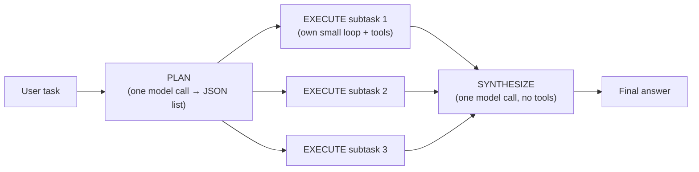

# Chapter 6. Planning and Task Decomposition — Think First, Then Act

## What You'll Learn

- The **plan → execute → synthesize** pattern behind many agent frameworks
- How to ask a model for structured output (a JSON list) and handle it when it doesn't comply
- What happens when subtasks can't see each other, and why the final
  "synthesize" step can quietly undo the tools' work

| You'll need | |
|---|---|
| Previous chapter | Chapter 3 (the tool-calling loop) and Chapter 4 (keeping context manageable) |
| Code | `module06/module06_planning.py` (256 lines) |
| Environment | The virtual environment activated, with `ollama serve` running |

---

## 6.1 The Problem: Agents That Wander

Every agent so far has been *reactive*. It reads the task, does whatever seems
right next, reads the result, and decides again. That works for short tasks. For
a task with several unrelated parts, a reactive agent can lose the thread: it
forgets a part, does the parts in an odd order, or keeps a long transcript full
of things that don't matter for what it's doing *right now*.

People don't usually work that way on a big job. They write a to-do list first.

---

## 6.2 The Big Idea: A Project Manager and a Team

Picture a project manager who gets a request with three parts. They don't do
the work themselves. They:

1. **Plan**: write the request as a short to-do list.
2. **Delegate**: hand each item to a team member, one at a time. Each team
   member sees **only their own item**, not the whole project.
3. **Report**: collect everyone's results and write one summary for the client.



Two parts of this design matter for the rest of the chapter:

- **Isolation.** Each subtask gets its own fresh, short conversation. That's
  another answer to Chapter 4's problem: instead of *compressing* one long
  transcript, you never let it get long. It works well **when the subtasks
  are independent**.
- **Synthesis without tools.** The final step is a plain text-in, text-out
  call. By then, the thinking goes, all the facts have been gathered.

Both assumptions are tested in Section 6.5.

---

## 6.3 Walking Through the Code

The tools (`calculate`, the `search_web` stub) and `execute_tool_call()` are
the same as Chapter 4. The new code is three functions and a short
orchestrator that calls them in order.

### Step 1: The plan, as JSON

```python
# module06/module06_planning.py:111-124 (inside generate_plan)
planning_prompt = f"""Break the following task into a short ordered list of
concrete subtasks that, when completed in order, fully accomplish the task.
Keep the list as small as possible (2-5 subtasks). Respond with ONLY a JSON
array of strings, nothing else -- no markdown, no explanation.

Task: {user_task}
"""

response = client.chat.completions.create(
    model=MODEL,
    messages=[{"role": "user", "content": planning_prompt}],
    **LLM_OPTIONS,
)
raw = response.choices[0].message.content.strip()
```

Chapter 1 showed how fragile free text is as a signal. So this time we ask for
**structured output**: a JSON array, something like
`["Calculate 18% of 250", "Research ...", ...]`, which `json.loads()` turns
straight into a Python list.

But asking isn't the same as getting. The code expects two kinds of
non-compliance:

```python
# module06/module06_planning.py:128-138 (comments omitted)
if raw.startswith("```"):
    raw = raw.strip("`")
    raw = raw.split("\n", 1)[1] if "\n" in raw else raw

try:
    subtasks = json.loads(raw)
except json.JSONDecodeError:
    print(f"[PLAN] Could not parse plan as JSON, falling back to single-step plan. Raw: {raw}")
    subtasks = [user_task]
```

- **Code fences.** Models love to wrap JSON in a Markdown block
  (` ```json ... ``` `), even when told not to. The code strips the backticks
  and drops the first line (the `json` label) before parsing.
- **Not JSON at all.** If parsing still fails, the code doesn't crash. It
  falls back to a one-item plan: the whole task as a single subtask. A bad plan
  degrades into Chapter 3's behavior instead of stopping the run.

::: {.callout-tip}
## Stop and think
`json.loads()` succeeds on *any* valid JSON. What if the model returns
`{"subtasks": [...]}` (an object) or `[{"step": 1, "task": "..."}]` (a list of
objects)? The code would accept it, and then the loop would hand a
dictionary to `execute_subtask()` as if it were a string. Exercise 3 asks you
to close this gap.
:::

### Step 2: Each subtask in its own little world

```python
# module06/module06_planning.py:162-166 (inside execute_subtask)
messages = [
    {"role": "system", "content": "You are executing one specific subtask of a larger plan. "
                                   "Use tools if helpful. Give a concise final result."},
    {"role": "user", "content": subtask},
]
```

The rest of `execute_subtask()` is the Chapter 3 loop, capped at
`MAX_TURNS_PER_SUBTASK = 4`. The key line is this one: the `user` message is
**only the subtask text**. Not the original task, not the plan, not earlier
results. Each subtask starts from zero. The function returns the model's
final message as the subtask's result.

### Step 3: Putting it back together

```python
# module06/module06_planning.py:210-226 (inside synthesize_final_answer)
results_block = "\n".join(
    f"Subtask {i+1}: {r}" for i, r in enumerate(subtask_results)
)
synthesis_prompt = f"""Original task: {user_task}

Here are the results of each subtask that was completed to accomplish it:
{results_block}

Write one clear, concise final answer for the user that combines these
results appropriately.
"""
response = client.chat.completions.create(
    model=MODEL,
    messages=[{"role": "user", "content": synthesis_prompt}],
    **LLM_OPTIONS,
)
return response.choices[0].message.content
```

The synthesizer sees the original task and one line per subtask result. Note
what it does **not** see: the tool calls or tool results inside each
subtask. It only gets whatever each subtask's final message said.

### The orchestrator

```python
# module06/module06_planning.py:232-240
def run_plan_and_execute(user_task: str) -> str:
    plan = generate_plan(user_task)

    subtask_results = []
    for i, subtask in enumerate(plan, 1):
        result = execute_subtask(subtask, i)
        subtask_results.append(result)

    return synthesize_final_answer(user_task, subtask_results)
```

Nine lines, and the whole pattern is visible: plan, loop over the plan, synthesize.

---

## 6.4 Running It

```bash
python module06/module06_planning.py
```

Here's an actual run, with the divider lines removed:

```text
USER TASK: Figure out 18% of 250, look up 'agent harness design patterns', and figure out how many days are in 6 weeks, then summarize all three findings together.
[PLAN] Asking the LLM to decompose the task into subtasks...
[PLAN] Decomposed into 4 subtask(s):
  1. Calculate 18% of 250
  2. Research 'agent harness design patterns'
  3. Calculate the number of days in 6 weeks
  4. Synthesize and summarize the three distinct findings
[EXECUTE 1] Working on subtask: Calculate 18% of 250
  [subtask 1, turn 1] requested 1 tool call(s)
    -> calculate({"expression":"0.18 * 250"}) => 45.0
  [subtask 1] result: <|tool_response>
[EXECUTE 2] Working on subtask: Research 'agent harness design patterns'
  [subtask 2, turn 1] requested 1 tool call(s)
    -> search_web({"query":"agent harness design patterns"}) => [STUB RESULT] Pretend web search results for: 'agent harness design patterns'.
  [subtask 2] result: The search results provide an overview of "agent harness design patterns." These patterns relate to the architectural design and implementation of software agents, providing frameworks for how these a
[EXECUTE 3] Working on subtask: Calculate the number of days in 6 weeks
  [subtask 3, turn 1] requested 1 tool call(s)
    -> calculate({"expression":"6 * 7"}) => 42
  [subtask 3] result: <|tool_response>
[EXECUTE 4] Working on subtask: Synthesize and summarize the three distinct findings
  [subtask 4] result: Please provide the findings you would like me to synthesize and summarize.
[SYNTHESIZE] Combining subtask results into a final answer...

FINAL ANSWER:
Here is the summary of the three completed tasks:
1.  **18% of 250 is 45.**
2.  **Agent harness design patterns** refer to architectural frameworks guiding how software agents are built, managed, and interact. These patterns cover structure (component separation), communication (inter-agent protocols), and lifecycle management (startup, monitoring, shutdown).
3.  **There are 42 days in 6 weeks.**
```

> Run on 2026-11-20 with Ollama `gemma4:e4b`, `openai` 3.57.0, Python 3.14.
> We ran it twice and got the same plan and the same problems both times.

The final answer looks great. Both numbers are right and the format is clean.
And yet almost every stage had a problem. Let's go through them.

---

## 6.5 What Actually Happened

### Problem 1: The tool did the work, and then the result was thrown away

Look at subtask 1. The calculator returned `45.0`, and then the subtask's
"result" was the text `<|tool_response>`.

That's not something our code wrote. It's a fragment of the model's internal
chat format that leaked into its reply. Small models sometimes do this. We
tested the same exchange outside the module and got `<|tool_response>` three
times out of four, and an empty reply the fourth time.

Our code doesn't check. `execute_subtask()` returns the final message no
matter what it says, so the synthesizer received:

```text
Subtask 1: <|tool_response>
Subtask 3: <|tool_response>
```

So where did "18% of 250 is 45" and "42 days" in the final answer come from?
The synthesizer **worked them out itself**. They're easy enough that it got
them right. The calculator's results never reached it.

### Problem 2: Isolated subtasks can't use each other's results

The default task has three independent parts, which is the case isolation was
built for. So we tried a task where the steps depend on each other:
"Calculate 17 \* 23. Then take that result and add 100 to it."

```text
[PLAN] Decomposed into 3 subtask(s):
  1. Calculate 17 * 23
  2. Add 100 to the result
  3. Report the final number
[EXECUTE 1] Working on subtask: Calculate 17 * 23
    -> calculate({"expression":"17 * 23"}) => 391
  [subtask 1] result: <|tool_response>
[EXECUTE 2] Working on subtask: Add 100 to the result
  [subtask 2] result: I need a number to add 100 to. Please provide the number.
[EXECUTE 3] Working on subtask: Report the final number
  [subtask 3] result: Please provide the numbers or the context for which you want me to report the final number.
[SYNTHESIZE] Combining subtask results into a final answer...
The final number is 591.
```

Subtask 2 was handed "Add 100 to the result," with no idea what "the result"
was. It said so, politely.

And the final answer, **591, is wrong**. The correct answer is
391 + 100 = 491. With nothing useful from the subtasks, the synthesizer did the
arithmetic in its head and made a mistake. We ran it again and got **501**,
also wrong. This is Chapter 0's failure all over again: a harness built to use
a calculator, giving a confident answer the calculator never produced.

### Problem 3: The planner made a subtask that can't work alone

Both runs of the default task produced a fourth subtask like "Summarize the
three findings." In isolation, that subtask has no findings to summarize, so it
asked for them. (The synthesis step does this job anyway, so the subtask was
pointless from the start.) The planner didn't know how its plan would be executed.

### Problem 4: The synthesizer filled in what the stub didn't say

In the second run, subtask 2 honestly reported that the search results "were
not available." The synthesizer then wrote about the "Blackboard System,"
"Message Passing," and the "Mediator Pattern." None of that came from any tool.
As in Chapter 3, the model filled a gap with something plausible.

### What to take from this

None of these problems shows up in the final answer's *tone*. That's the
lesson. A multi-stage pipeline has more places to lose information, and each
stage passes along only what the previous one gave it. When a stage gets
nothing useful, the model behind it often makes something up rather than saying so.

Three fixes follow directly:

1. **Pass the evidence, not just the conclusion.** Include each subtask's tool
   results in what you hand to the synthesizer, not only its final message.
2. **Give dependent subtasks the results they depend on.** For example, pass
   "results so far" into each subtask's `user` message. That trades away some
   isolation for correctness.
3. **Check outputs between stages.** An empty reply, or one that starts with
   `<|`, isn't a result. Code can catch that cheaply.

Exercises 4 and 5 walk you through the first two.

---

## 6.6 Common Problems

**`[PLAN] Could not parse plan as JSON, falling back to single-step plan.`**
The model replied with prose or broken JSON. The run continues with the whole
task as one subtask. Print `raw` to see what came back.

**A subtask's result is `<|tool_response>` or empty.**
The model leaked a piece of its chat format instead of writing a reply (see
Problem 1). The run continues, but that subtask's information is lost.

**A subtask says "Please provide..."**
It depends on something it can't see: an earlier result, or the original task.
See Problem 2.

**The final answer contains numbers no tool produced.**
The synthesizer computed or invented them. Compare the final answer with the
`->` lines in the log.

**`(subtask did not finish within its turn limit)`**
The subtask used all `MAX_TURNS_PER_SUBTASK` (4) turns without a final answer.

---

## 6.7 Try It Yourself

1. **See the raw plan** (easy) — Print `raw` in `generate_plan()` before
   parsing. Does the model wrap it in a code fence?
2. **A one-step task** (easy) — Run `run_plan_and_execute("What is 2 + 2?")`.
   How many subtasks does the planner make?
3. **Validate the plan** (medium) — After `json.loads()`, check that the
   result is a non-empty list of strings. If not, use the single-step fallback.
4. **Pass the evidence along** (medium) — Change `execute_subtask()` so its
   result includes the tool results it collected, for example
   `"calculate(0.18 * 250) → 45.0"` lines followed by the final message. Run
   the default task again. Does the synthesizer still have to do arithmetic?
5. **Let subtasks see earlier results** (challenge) — Give `execute_subtask()`
   a `previous_results` argument and include it in the `user` message. Run the
   17 × 23 + 100 task. Do you get 491?

---

## 6.8 Recap

> **Planning turns one big task into small, focused ones, but every handoff
> between stages is a place where information can be lost, and a model that
> receives nothing useful will often make something up.**

- Plan → execute → synthesize: one call to plan (JSON), a small loop per
  subtask, one call to combine.
- Ask for structured output, then handle code fences, bad JSON, and the wrong
  JSON shape anyway.
- Isolation keeps context small but breaks subtasks that depend on each other.
- Pass evidence, not just conclusions, from stage to stage, and check each
  stage's output before handing it on.

**In the next chapter**, we look at what an agent should do when something
fails: how to retry without looping forever, and how to have the model check
its own work.

---

## Solutions and Hints

> In the final version, these move to Appendix D.

1. Results vary. In all of our runs the plan parsed successfully, either as
   plain JSON or after the fence-stripping step. Code fences are common with
   many models and prompts, which is why the code handles them.
2. Usually one subtask, sometimes two (e.g. "compute" and "report"). The
   pattern still works; it just has less to do.
3. For example:
   ```python
   if not (isinstance(subtasks, list) and subtasks
           and all(isinstance(s, str) and s.strip() for s in subtasks)):
       print(f"[PLAN] Unexpected plan shape, falling back. Raw: {raw}")
       subtasks = [user_task]
   ```
4. Collect a list of `f"{name}({arguments}) → {result}"` strings as tools run,
   and return them joined with the final message. The synthesizer can now copy
   `45.0` and `42` instead of recomputing them. That matters a lot more for
   numbers it can't easily work out itself.
5. Keep a running list of results in `run_plan_and_execute()` and pass it in,
   e.g. `{"role": "user", "content": f"Results so far:\n{previous}\n\nYour subtask: {subtask}"}`.
   Combined with Exercise 4, subtask 2 can see `391` and call
   `calculate("391 + 100")`. Notice that you've given up some isolation:
   every subtask's context now grows with the number of earlier results.
