# Chapter 8. Parallel Execution — Doing Independent Work at the Same Time

## What You'll Learn

- Just enough `async`/`await` to read and write concurrent Python
- How `asyncio.gather` runs independent tool calls together, and how a
  semaphore keeps you from running too many at once
- Why speeding up the tools sped up our agent far less than you'd expect

| You'll need | |
|---|---|
| Previous chapter | Chapter 3: the tool-calling loop. Chapter 3 also showed the model asking for two tools in one response |
| Code | `module08/module08_parallel_execution.py` (209 lines) |
| Environment | The virtual environment activated, with `ollama serve` running |

---

## 8.1 The Problem: Waiting in Line for No Reason

Back in Chapter 3, the model asked for a web search and a calculation **in the
same response**. They didn't depend on each other. Yet our loop ran them one
after the other:

```python
for tool_call in message.tool_calls:
    tool_result = execute_tool_call(tool_call)
```

For a calculator, that doesn't matter: it takes microseconds. For tools that
wait on the network, like a real web search, an API call, or a database query,
each call might take a second or more, and most of that time is spent
**waiting**, not computing. Three searches in a row means three waits in a row.

---

## 8.2 The Big Idea: A Cook With Several Pots

A cook making pasta, sauce, and vegetables doesn't stand and watch the pasta
water boil before starting the sauce. They put the water on, start the sauce,
and chop vegetables while both heat up. There's still one cook. The trick is
not waiting around during the parts that are just waiting.

That's **concurrency**: one program, juggling several tasks that are each
mostly waiting. When the model asks for three searches at once, we start all
three, wait for all of them together, and continue when the last one is done.

```mermaid
gantt
    title Three 1.5-second searches
    dateFormat  x
    axisFormat  %S.%Ls
    section One at a time
    search 1 :s1, 0, 1500ms
    search 2 :s2, after s1, 1500ms
    search 3 :s3, after s2, 1500ms
    section Concurrent
    search 1 :c1, 0, 1500ms
    search 2 :c2, 0, 1500ms
    search 3 :c3, 0, 1500ms
```



There's a catch. Real services limit how many requests you can send at once.
Start 50 searches together and you may get rate-limit errors instead of
results. So we also need a way to say "at most three at a time."

---

## 8.3 A Five-Minute Introduction to `async` and `await`

This is the first module that uses Python's `asyncio`. Here's what you need
to read it. (For more depth, Real Python's
[asyncio walkthrough](https://realpython.com/async-io-python/) is excellent.)

**`async def` makes a coroutine function.** Calling it doesn't run it. It
gives you a *coroutine*, a task that's ready to run:

```python
async def fetch():
    await asyncio.sleep(1.5)   # pretend to wait on the network
    return "done"

fetch()          # → a coroutine object; nothing has happened yet
```

**`await` runs a coroutine and waits for its result**, and while it's waiting,
Python is free to run *other* coroutines. That's the cook stepping away from
the pot. You can only use `await` inside an `async def`.

**`asyncio.gather(...)` runs several coroutines at the same time** and gives
back all their results, in the same order you passed them in:

```python
results = await asyncio.gather(fetch(), fetch(), fetch())
# takes about 1.5 seconds, not 4.5
```

**`asyncio.run(main())` starts everything.** It's the bridge from ordinary
Python into the async world, and you call it once, at the top of the program.

**One important rule:** concurrency only helps while code is *waiting*
(`await asyncio.sleep(...)`, `await` on a network call). Ordinary Python code
that keeps the processor busy, like a big loop, doesn't let anything else run.
That's why this works for network-bound tools and does nothing for a calculator.

---

## 8.4 Walking Through the Code

### An async client and a "slow" tool

```python
# module08/module08_parallel_execution.py:46
client = AsyncOpenAI(base_url=BASE_URL, api_key=API_KEY)
```

`AsyncOpenAI` is the async twin of the `OpenAI` client: the same API, but
its methods must be `await`ed.

```python
# module08/module08_parallel_execution.py:100-107 (docstring omitted)
async def search_web(query: str) -> str:
    await asyncio.sleep(1.5)  # pretend this is a slow network call
    return f"[STUB RESULT] Pretend web search results for: '{query}'."
```

The stub now *pretends* to wait 1.5 seconds, the way a real search would. That
fake delay is what lets us measure anything. Every tool is now `async def`,
even `calculate`, so the loop can treat them all the same way.

### The rate limiter

```python
# module08/module08_parallel_execution.py:53-54
MAX_CONCURRENT_CALLS = 3
rate_limiter = asyncio.Semaphore(MAX_CONCURRENT_CALLS)
```

A *semaphore* is a counter of permits. Think of a restaurant with three
tables: when all three are taken, the next party waits at the door until
someone leaves.

```python
# module08/module08_parallel_execution.py:117-129 (inside execute_tool_call)
async with rate_limiter:
    tool_name = tool_call.function.name
    tool_fn = TOOL_REGISTRY.get(tool_name)
    if tool_fn is None:
        return f"ERROR: unknown tool '{tool_name}'."
    try:
        tool_args = json.loads(tool_call.function.arguments)
    except json.JSONDecodeError as e:
        return f"ERROR: could not parse arguments as JSON: {e}"
    try:
        return str(await tool_fn(**tool_args))
    except Exception as e:
        return f"ERROR: tool '{tool_name}' raised an exception: {e}"
```

This is Chapter 3's error handling, inside `async with rate_limiter:`.
Entering the block takes a permit (or waits for one); leaving it, by any
`return`, gives the permit back. However many tool calls the model requests,
at most three run at once.

### The key line

```python
# module08/module08_parallel_execution.py:162-177 (comments and prints omitted)
start = time.monotonic()
results = await asyncio.gather(*[
    execute_tool_call(tc) for tc in message.tool_calls
])
elapsed = time.monotonic() - start

for tool_call, tool_result in zip(message.tool_calls, results):
    messages.append({
        "role": "tool",
        "tool_call_id": tool_call.id,
        "content": tool_result,
    })
```

Read it in three parts:

1. `[execute_tool_call(tc) for tc in ...]` builds a list of coroutines,
   one per tool call. None of them has started yet.
2. `asyncio.gather(*...)` starts them all and waits for every one. (The `*`
   unpacks the list into separate arguments.)
3. `zip(...)` pairs each tool call with its result. This works because
   `gather` returns results **in the order you passed them in**, even if the
   third search finished first. And because each result is labeled with its
   `tool_call_id`, the order of the `tool` messages wouldn't confuse the model
   anyway.

`time.monotonic()` is a clock meant for measuring durations. Unlike the time
of day, it never jumps backward when your computer adjusts its clock.

The rest of the loop is unchanged, apart from `await` before
`client.chat.completions.create(...)`. The program starts with
`asyncio.run(main())` at the bottom of the file.

---

## 8.5 Running It

```bash
python module08/module08_parallel_execution.py
```

The task asks for three separate searches. Here's an actual run:

```text
USER TASK: Search the web separately for these 3 topics: 'agent harness design', 'LLM tool calling', and 'async rate limiting'. Then briefly summarize each.
[STEP 1] Sending 2 messages to the LLM...
[STEP 1] LLM requested 3 tool call(s). Executing concurrently...
[STEP 1] All 3 tool call(s) finished in 1.50s (sequential would have taken roughly 4.50s for the search tool alone).
  -> search_web({"query":"agent harness design"}) => [STUB RESULT] Pretend web search results for: 'agent harness design'.
  -> search_web({"query":"LLM tool calling"}) => [STUB RESULT] Pretend web search results for: 'LLM tool calling'.
  -> search_web({"query":"async rate limiting"}) => [STUB RESULT] Pretend web search results for: 'async rate limiting'.
[STEP 2] Sending 6 messages to the LLM...
[STEP 2] LLM gave a final answer (no tool call).

FINAL ANSWER:
I have performed the three separate web searches. Since I cannot see the actual search results, I will provide you with a *template* for how I would summarize them based on common knowledge of these technical topics.
...
Total wall-clock time: 13.08s
```

> Run on 2026-11-20 with Ollama `gemma4:e4b` on a laptop, `openai` 3.57.0,
> Python 3.14. Timings depend heavily on your hardware.

The model asked for all three searches in one response, and the three
1.5-second searches finished in **1.50 seconds** together. Concurrency worked
exactly as promised.

(A nice surprise in the final answer: this time the model noticed the stub
results were empty and said so, offering a clearly labeled "template" instead
of inventing findings. Compare Chapters 3 and 6. Same kind of stub, different
behavior from run to run.)

### Measuring the limiter

To see the semaphore at work, we called `execute_tool_call()` directly with
batches of fake searches and timed each batch, with no model involved:

| How we ran the searches | Searches | Limit | Time |
|---|---|---|---|
| A plain `for` loop | 3 | — | 4.51 s |
| `gather` | 3 | 3 | 1.50 s |
| `gather` | 3 | 1 | 4.51 s |
| `gather` | 5 | 3 | 3.00 s |
| `gather` | 6 | 3 | 3.00 s |
| `gather` | 10 | 10 | 1.50 s |

Each row is easy to predict once you think of the semaphore as tables in a
restaurant. With a limit of 1, `gather` is no faster than a loop: everyone
waits for the one table. Five searches with a limit of 3 take two "rounds"
(three, then two), and so do six. Raise the limit to 10 and all ten run in one round.

The right limit isn't "as high as possible." It's whatever your provider allows.

---

## 8.6 Where Did the Time Actually Go?

Look at the run again: tools took **1.50 s**, and the whole run took
**13.08 s**. (A second run: 12.85 s.) So about **11.5 seconds** were spent
waiting for the model, in two calls.

Run the tools one at a time, and the total would have been about 16 seconds
instead of 13. Concurrency saved 3 seconds, about 20%. That's real, but it's
not the "3× faster" the tool timings suggest.

This is a general rule, sometimes called **Amdahl's law**: speeding up one
part of a job can only save as much time as that part was taking. In a typical
agent, the model calls are the slowest part, and `gather` here only
parallelizes the tools. Before optimizing anything, measure where the time
really goes.

Two ways to go further, both beyond this module:

- **Fewer model calls.** Each step costs a model call. Getting the model to
  request independent tools together (as this module's system prompt
  encourages) saves whole round trips, which matters more than how fast the
  tools run.
- **Parallel model calls.** Chapter 6's independent subtasks each make
  their own model calls. Running those with `gather` could overlap model time,
  too. Whether it actually speeds up depends on your provider: a hosted API
  handles many requests at once, while a single local Ollama server may queue
  them, depending on how it's configured.

---

## 8.7 Common Problems

**`RuntimeWarning: coroutine '...' was never awaited`.**
You called an `async def` function without `await`. Calling it only creates a
coroutine; `await` (or `gather`) is what runs it.

**`SyntaxError: 'await' outside async function`.**
`await` only works inside `async def`. The top of the program uses
`asyncio.run(main())` instead.

**The parallel version isn't faster.**
Either the model asked for one tool per step (check that `requested N tool
call(s)` shows N > 1), `MAX_CONCURRENT_CALLS` is 1, or the tools don't wait on
anything (like `calculate`), so there's nothing to overlap.

**"sequential would have taken roughly ..." is wrong.**
That estimate is just `n × 1.5`, which assumes every call is a search. If one
of the calls is `calculate`, the real sequential time is shorter.

**The total time barely improved.**
The model calls dominate. See Section 8.6.

---

## 8.8 Try It Yourself

1. **One table only** (easy) — Set `MAX_CONCURRENT_CALLS = 1` and run the
   module. How long does the tool step take now?
2. **Predict, then measure** (easy) — With a limit of 3, how long should 7
   searches take? Write down your guess, then check it with a batch like the
   one in Section 8.5.
3. **Time the model, too** (medium) — Wrap the `client.chat.completions.create`
   call with `time.monotonic()` and print how long each model call takes.
   What fraction of the total is model time?
4. **Fix the estimate** (medium) — Make the "sequential would have taken"
   message count only the `search_web` calls instead of all calls.
5. **Parallel subtasks** (challenge) — Take Chapter 6's `execute_subtask()`,
   make it `async` with `AsyncOpenAI`, and run all subtasks with `gather`.
   Is it faster on your setup? (Hint: it depends on how many requests your
   model server handles at once.)

---

## 8.9 Recap

> **Run independent, waiting-heavy work concurrently, cap it with a semaphore,
> and measure the whole run, because the part you sped up may not be the part
> that was slow.**

- `async def` makes a coroutine; `await` runs it; `asyncio.gather` runs
  several at once and returns results in order.
- `async with semaphore:` caps how many run at the same time; the right cap is
  whatever your provider allows.
- Three 1.5-second searches took 1.50 s instead of 4.5 s, but the whole run
  went from about 16 s to 13 s, because the model calls dominate.

**In the next chapter**, we shift from making the agent faster to making it
safer: what should happen before an agent does something that can't be undone?

---

## Solutions and Hints

Solutions to this chapter's exercises are in [Appendix D](../appendices/appendix-d-solutions.md#chapter-8-parallel-execution).
