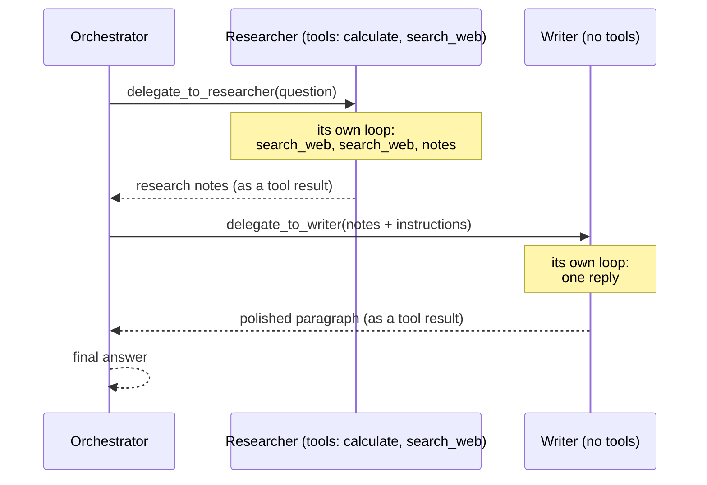

# Chapter 11. Multi-Agent Orchestration — Agents That Call Agents

## What You'll Learn

- The **sub-agents as tools** pattern: an orchestrator whose "tools" are whole agents
- How one generic loop function can run three agents with different prompts and tools
- What multi-agent systems cost, and how a fact can lose its source as it
  passes from agent to agent

| You'll need | |
|---|---|
| Previous chapter | Chapter 3 (the tool-calling loop) and Chapter 6 (plan, execute, synthesize) |
| Code | `module11/module11_multi_agent.py` (260 lines) |
| Environment | The virtual environment activated, with `ollama serve` running |

---

## 11.1 The Problem: One Agent, One Personality

In Chapter 6, a planner split a task into subtasks, but every subtask ran with
the same system prompt and the same tools. Sometimes you want genuinely
different specialists:

- A **researcher** that uses search and calculation tools, and writes terse notes.
- A **writer** that has no tools at all, and turns notes into polished prose.

Each one has its own instructions, its own tools, and potentially even its own
model. How do you get them to work together?

---

## 11.2 The Big Idea: A Manager Who Delegates

Picture a manager with two team members. The manager doesn't research or
write. They hand a question to the researcher, wait for notes, hand the notes
to the writer, wait for the draft, and give the draft to the client.

From the manager's point of view, handing work to a team member is just like
using any other tool: send a request, get a result. The manager doesn't need to
know *how* the researcher did the work.

That's this chapter's pattern. The orchestrator is an ordinary Chapter 3 agent.
Its two "tools" are `delegate_to_researcher` and `delegate_to_writer`. When it
calls one, **a complete agent loop runs inside that function**, and the
sub-agent's final answer comes back as the tool result.



No new mechanism is needed. A multi-agent system here is one agent whose tools
happen to be other agents.

---

## 11.3 Walking Through the Code

### One loop for every agent

```python
# module11/module11_multi_agent.py:48-63 (start of run_tool_calling_loop)
def run_tool_calling_loop(system_prompt: str, user_message: str, tools_schema: list,
                            tool_registry: dict, agent_label: str) -> str:
    messages = [
        {"role": "system", "content": system_prompt},
        {"role": "user", "content": user_message},
    ]

    for turn in range(1, MAX_TURNS_PER_AGENT + 1):
        print(f"    [{agent_label} | turn {turn}] calling LLM with {len(messages)} messages...")
        response = client.chat.completions.create(
            model=MODEL,
            messages=messages,
            tools=tools_schema if tools_schema else None,
            **LLM_OPTIONS,
        )
```

This is the Chapter 3 loop with everything that varies turned into a
parameter: the system prompt, the first user message, the tools, the tool
registry, and a label for the log. The rest of the function is the familiar
"run the tools, append the results, loop again" code.

`tools=tools_schema if tools_schema else None` handles the writer, which has
no tools: we pass `None` instead of an empty list. Each call to this function
starts its own fresh `messages` list, so the agents never share a transcript.

(As in Chapter 10, `json.loads()` on the tool arguments isn't wrapped in a
`try`, so broken JSON from any of the three agents ends the whole run.)

### The researcher

```python
# module11/module11_multi_agent.py:99-102
RESEARCHER_SYSTEM_PROMPT = """You are a research specialist. Use your tools
to gather facts and figures relevant to the question. Respond with concise,
factual notes -- NOT polished prose. Just the raw findings.
"""
```

```python
# module11/module11_multi_agent.py:143-156 (docstring omitted)
def delegate_to_researcher(question: str) -> str:
    return run_tool_calling_loop(
        system_prompt=RESEARCHER_SYSTEM_PROMPT,
        user_message=question,
        tools_schema=RESEARCHER_TOOLS_SCHEMA,
        tool_registry=RESEARCHER_TOOL_REGISTRY,
        agent_label="RESEARCHER",
    )
```

That's the whole trick. `delegate_to_researcher` is an ordinary Python function
that takes a string and returns a string, exactly like `calculate`. Inside, it
runs a full agent with the researcher's prompt and tools (`calculate` and the
`search_web` stub).

### The writer

```python
# module11/module11_multi_agent.py:165-169
WRITER_SYSTEM_PROMPT = """You are a writing specialist. You will be given
raw research notes and instructions. Turn them into clear, polished,
well-organized prose suitable for a non-technical reader. Do not invent
facts not present in the notes.
"""
```

`delegate_to_writer` is the same shape, with `tools_schema=[]` and
`tool_registry={}`. Notice the last sentence of the prompt: "Do not invent
facts not present in the notes." Keep it in mind for Section 11.5.

### The orchestrator

```python
# module11/module11_multi_agent.py:194-199
ORCHESTRATOR_SYSTEM_PROMPT = """You are an orchestrator managing two
specialists: a researcher (for gathering facts/figures) and a writer (for
producing polished prose from notes). Delegate appropriately -- typically
research first, then pass its notes to the writer. Give the final polished
text as your own last message once the writer has produced it.
"""
```

```python
# module11/module11_multi_agent.py:228-231
ORCHESTRATOR_TOOL_REGISTRY = {
    "delegate_to_researcher": delegate_to_researcher,
    "delegate_to_writer": delegate_to_writer,
}
```

The orchestrator's schema describes two tools with one string argument each
(`question` and `notes_and_instructions`). Its registry maps those names to
the delegate functions. `run_orchestrator()` then just calls
`run_tool_calling_loop()` with the orchestrator's prompt, schema, and registry.

The orchestrator has no idea its tools are agents. It's the same loop you
wrote in Chapter 3, three levels deep.

---

## 11.4 Running It

```bash
python module11/module11_multi_agent.py
```

To see more than the default log shows, we wrapped the two delegate functions
to print exactly what passed between the agents, and we counted every model
call. Here's one run, lightly trimmed:

```text
[ORCHESTRATOR] Starting top-level orchestration loop...
    [ORCHESTRATOR | turn 1] calling LLM with 2 messages...
    [ORCHESTRATOR | turn 1] -> delegate_to_researcher({'question': "What is an 'agent harness' in the context of AI, and why is 'tool calling' important for AI agents?"})
    [RESEARCHER | turn 1] calling LLM with 2 messages...
    [RESEARCHER | turn 1] -> search_web({'query': 'agent harness in AI'})
    [RESEARCHER | turn 1] <- [STUB RESULT] Pretend web search results for: 'agent harness in AI'.
    [RESEARCHER | turn 2] calling LLM with 4 messages...
    [RESEARCHER | turn 2] -> search_web({'query': 'why is tool calling important for AI agents'})
    [RESEARCHER | turn 2] <- [STUB RESULT] Pretend web search results for: 'why is tool calling important for AI agents'.
    [RESEARCHER | turn 3] calling LLM with 6 messages...
    [RESEARCHER] finished after 3 turn(s).

>>> RESEARCHER RETURNED:
**Agent Harness:**
*   **Definition:** A framework or structure designed to manage and execute the lifecycle of an AI agent.
*   **Function:** Provides the necessary scaffolding to enable an agent to operate beyond simple conversational turns.
*   **Components:** Often includes components for memory management, planning/reasoning loops, external tool integration, and execution flow control.
...
**Tool Calling in AI Agents:**
*   **Importance:** Enables AI agents to break out of the limitations of their pre-trained knowledge base.
...
<<<

    [ORCHESTRATOR | turn 2] calling LLM with 4 messages...
>>> ORCHESTRATOR SENT WRITER:
**Notes:**
*   **Agent Harness:** A framework/structure for managing AI agent operations. It provides scaffolding for multi-step tasks, memory, planning, and tool use.
*   **Tool Calling:** Allows the AI to go beyond its training data. The LLM outputs structured calls (like JSON) specifying a function and arguments.
*   **Importance of Tool Calling:** Enables real-time data access (weather, stocks), complex actions (booking), and specialized logic that the model can't do inherently.

**Goal:** Write a short paragraph for a general audience explaining both concepts. ...
<<<
    [WRITER | turn 1] calling LLM with 2 messages...
    [WRITER] finished after 1 turn(s).
    [ORCHESTRATOR | turn 3] calling LLM with 6 messages...
    [ORCHESTRATOR] finished after 3 turn(s).

FINAL ANSWER:
The final polished text is:
Imagine an AI like a highly capable but somewhat limited student. An **Agent Harness** acts like the student's entire support system—it's the framework that allows the student to break down a complex assignment into manageable steps, remember what they learned previously, and plan their approach. ...

MODEL CALLS: 7, total 28.9s
```

> Run on 2026-11-20 with Ollama `gemma4:e4b`, `openai` 3.57.0, Python 3.14.
> We ran it twice; both runs had the same structure and 7 model calls.

The indentation tells the story: the researcher's and writer's turns happen
*inside* the orchestrator's first and second turns. The orchestrator
delegated research, then writing, then returned the result, exactly as its
prompt describes. The final paragraph reads well and suits a general audience.

---

## 11.5 What Happened Between the Agents

### The researcher's "findings" came from nowhere

Both searches returned `[STUB RESULT]`. The researcher still produced detailed
notes, with definitions, components, and capabilities. Every word came from the
model's own knowledge, but the notes don't say so. They're formatted exactly as
if they were "raw findings" from research.

Our second run made the problem plain. Same question, same stub, and this time
the researcher's notes defined an agent harness as a framework "used to
evaluate, manage, and orchestrate AI agents," with a "standardized environment
for designing, testing, and deploying" agents. That's closer to Chapter 0's
"testing environment" guess. **The two runs disagreed on the basic definition**,
and each delivered it with the same confidence.

### The writer followed its rule, and it didn't help

The writer was told, "Do not invent facts not present in the notes." As far as
we can tell, it obeyed: the final paragraph sticks to what the notes say. But
the notes were already invented. A rule that guards the *last* step can't catch
a problem introduced at the *first*.

Call it **fact laundering**: a guess goes in as "research notes," comes out as
"facts from the notes," and reaches the user as polished prose. At each hop it
looks more trustworthy, and at each hop, the information about where it came
from is gone.

### The orchestrator edited the notes on the way through

Compare what the researcher returned with what the orchestrator sent the
writer. The orchestrator **rewrote** the notes: shorter, rephrased, and with
its own additions, like "using analogies if helpful." The writer never saw the
researcher's actual output. It saw the orchestrator's summary of it. Every agent
in the chain is another model rewriting the previous one's text, so details
drift, like a game of telephone.

### It's not cheap

Seven model calls for one paragraph: three for the orchestrator, three for the
researcher, one for the writer. About 27–29 seconds in total.

The orchestrator's last call, about 5–6 seconds, did nothing but repeat the
writer's paragraph back, with "The final polished text is:" stuck on the front.
We paid for a whole model call to copy text that was already finished.

### What to take from this

The sub-agents-as-tools pattern is genuinely elegant, and it's how many real
multi-agent systems work. But every boundary between agents is a place where
evidence can be lost, rewritten, or replaced. Some ways to keep that in check:

1. **Carry the evidence, not just the conclusion.** Have the researcher return
   its tool results alongside its notes, and pass them along. (This is
   Chapter 6's lesson again.)
2. **Make "unknown" a valid answer.** Tell the researcher to say plainly when a
   search returned nothing, and check for it in code.
3. **Pass outputs through unchanged when possible.** If the writer's text is
   the final answer, return it directly instead of asking the orchestrator to
   retype it.
4. **Trace every agent.** Chapter 10's tracer, with a separate label per agent,
   is what let us see all of this.

---

## 11.6 Common Problems

**The orchestrator answers by itself without delegating.**
It decided the task didn't need help. Make the system prompt firmer ("always
use the researcher first"), or run it again.

**`(RESEARCHER did not finish within its turn limit.)`**
The researcher used all `MAX_TURNS_PER_AGENT` (6) turns, probably by searching
repeatedly. That message becomes the tool result, and the orchestrator decides
what to do with it.

**The final answer starts with "The final polished text is:".**
The orchestrator wrapped the writer's output. See "It's not cheap" above.

**The definitions change from run to run.**
They're coming from the model, not from a source, because the search is a stub.
See Section 11.5.

**A run takes much longer than earlier chapters.**
Each delegation is a full agent loop with its own model calls. Count them with
a wrapper like ours, or with Chapter 10's tracer.

---

## 11.7 Try It Yourself

1. **Count the calls** (easy) — Add a counter that increases every time
   `client.chat.completions.create` is called, and print it at the end. Do you
   also get 7?
2. **See the handoffs** (easy) — Wrap `delegate_to_writer` so it prints its
   input before calling the real function, as we did. How much does the
   orchestrator change the researcher's notes?
3. **An honest researcher** (medium) — Add to the researcher's prompt: "If a
   tool returns no real information, say 'NO SOURCE FOUND' for that topic
   instead of writing notes from memory." What does the writer produce now?
4. **Skip the copy** (medium) — Change the code so that when the writer
   finishes, its text is returned as the final answer without another
   orchestrator call. How many calls and seconds does that save?
5. **A fact-checker** (challenge) — Add a third specialist,
   `delegate_to_fact_checker`, that receives the notes *and* the raw tool
   results and flags any claim the tool results don't support. Wire it in
   between the researcher and the writer. What does it flag?

---

## 11.8 Recap

> **A multi-agent system can be one agent whose tools are other agents, but
> every handoff between agents is a place where facts can lose their source.**

- `run_tool_calling_loop()` runs any agent: pass a different prompt, tools,
  and registry, and you get a different specialist.
- `delegate_to_researcher` and `delegate_to_writer` look like ordinary tools
  to the orchestrator; inside, each runs a full agent loop.
- In our runs, the researcher turned stub searches into confident notes, the
  orchestrator rewrote those notes, and the writer faithfully polished them.
  Seven model calls produced one paragraph.

That completes Part III. You've now seen the ideas that make an agent more
capable and more trustworthy: planning, recovery, parallelism, guardrails,
tracing, and delegation. Each one was a branch off the same Chapter 3 loop.
**In Part IV**, we pull the core of that loop into a reusable library, connect
it to tools in a separate process, and look at what it takes to go to production.

---

## Solutions and Hints

> In the final version, these move to Appendix D.

1. Wrap the method once at the top of `run_orchestrator()` or in your own
   script:
   ```python
   real_create = client.chat.completions.create
   count = 0
   def counted(**kwargs):
       global count
       count += 1
       return real_create(**kwargs)
   client.chat.completions.create = counted
   ```
   You'll usually see 7: three orchestrator turns, two or three researcher
   turns, and one writer turn. It changes if the researcher searches more or less.
2. In our runs, the orchestrator always condensed and rephrased the notes, and
   added its own instructions about tone. Sometimes it also added details, so
   compare carefully.
3. With nothing real to go on, the writer should produce a short paragraph
   saying the information couldn't be found, or the orchestrator may decide not
   to call the writer at all. Either is more honest than a confident paragraph
   built on nothing.
4. One approach: in `delegate_to_writer`, store the writer's output in a
   variable outside the function, and after `run_orchestrator()` returns,
   return that stored text if it exists. In our runs, this would save one call
   and about 5–6 seconds.
5. Have `delegate_to_researcher` return both its notes and the list of
   `role="tool"` contents from its `messages` (you'll need to change
   `run_tool_calling_loop()` to return those too). With stub searches, a good
   fact-checker should flag nearly every claim, which is the right answer.
