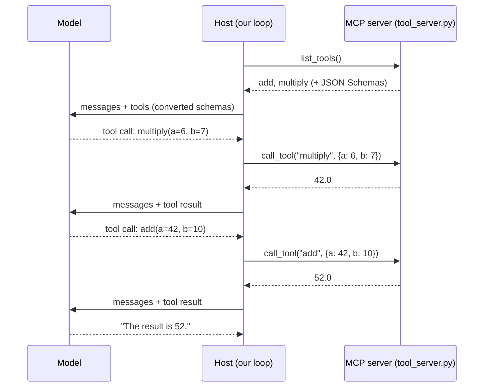

# Chapter 13. Connecting External Tools With MCP — Tools in Another Process

## What You'll Learn

- What the **Model Context Protocol (MCP)** standardizes, and what it doesn't
- How a host discovers tools from a separate server and calls them, with the
  same agent loop you've used since Chapter 3
- The difference between a **tool error** (the model can fix it) and a
  **connection error** (it can't), and why the code treats them differently

| You'll need | |
|---|---|
| Previous chapter | Chapter 3 (the registry and loop) and Chapter 8, Section 8.3 (`async`/`await`) |
| Code | `module13/tool_server.py`, `module13/inspect_tools.py`, `module13/module13_mcp_tools.py` |
| Environment | **Python 3.10+**, this module's pinned packages (see below), and `ollama serve` for Step 2 |

Install this module's dependencies first. As "Before You Begin" explains, it's
simplest to use a separate virtual environment for this chapter, because the
pinned `openai` version is older than the one used in Chapters 0–12:

```bash
python3 -m venv .venv13
```

```bash
source .venv13/bin/activate
```

```bash
python -m pip install -r module13/requirements.txt
```

The file pins `mcp==2.2.0` and `openai==3.19.2`, a combination tested together.
MCP's Python SDK changed its API in version 2, so examples written for older
versions (you may see `FastMCP` in tutorials) won't work with this code.

---

## 13.1 The Problem: Every Tool Lives Inside Your Program

Every tool so far has been a Python function in the same file as the agent, or
at least the same program. That's simple, but it has limits:

- **Tools can't be shared.** If two applications both need a "search our
  company wiki" tool, each has to include its own copy.
- **Tools must be written in Python**, in the same environment, with the same
  dependencies as the agent.
- **Someone else's tools can't be plugged in** without copying their code into
  yours.

What if the tools lived in their own program, and any agent could ask that
program "what tools do you have?" and "please run this one"?

---

## 13.2 The Big Idea: A Standard Plug

Think of a wall outlet. Your lamp doesn't know which power station made the
electricity, and the power station doesn't know you own a lamp. They agree on
the shape of the plug, and that's enough.

**MCP is a standard plug between an agent and its tools.** It defines how a
program that *has* tools (an MCP **server**) tells a program that *uses* them
(the **host**, through its MCP **client**) what's available, and how the host
asks for one to run.

| Term | In this module |
|---|---|
| **Host** | Our application: it talks to the model, keeps the messages, runs the loop |
| **Client** | The SDK's `Client` object inside the host, which talks to the server |
| **Server** | `tool_server.py`: a separate program offering `add` and `multiply` |

"Server" doesn't have to mean a remote computer. Here, the client **starts the
server as a child process** on your own machine, and the two exchange messages
over *stdio* (the program's standard input and output). There's no port and no
second terminal.

What MCP **doesn't** change is just as important:



The model still asks for tools the way it always has. The loop still runs the
show. **The only thing that moves is where the tool code lives**, and how the
host finds out about it. The server has no model and makes no decisions.

---

## 13.3 Walking Through the Code, Part 1: The Server

```python
# module13/tool_server.py:7-25
from mcp.server import MCPServer

mcp = MCPServer("Course arithmetic")


@mcp.tool()
def add(a: float, b: float) -> float:
    """Add two numbers and return their sum."""
    return a + b


@mcp.tool()
def multiply(a: float, b: float) -> float:
    """Multiply two numbers and return their product."""
    return a * b


if __name__ == "__main__":
    mcp.run(transport="stdio")
```

This should look familiar. `@mcp.tool()` is the SDK's version of Chapter 3's
`@tool`, with one big convenience: **you don't write the schema.** The SDK
builds it from the function's name, its docstring (the description), and its
**type hints** (`a: float`, `b: float`). That's a good reason to write type
hints and docstrings carefully: here, they're the documentation the model reads.

`mcp.run(transport="stdio")` waits for protocol messages on standard input.
Because standard output is the channel back to the client, **the server must
not `print()` to stdout**. A stray print would corrupt the conversation. Debug
output goes to stderr instead: `print(..., file=sys.stderr)`.

---

## 13.4 Walking Through the Code, Part 2: Talking to the Server Without a Model

`inspect_tools.py` connects to the server, lists its tools, and calls one,
with **no model involved**. Start here: if this works, MCP is working, and any
later problem is somewhere else.

### Connecting

```python
# module13/inspect_tools.py:30-35 (inside connect_server)
params = StdioServerParameters(
    command=sys.executable, args=[str(Path(server_path).resolve())],
)
with anyio.fail_after(session_timeout):
    async with Client(params, read_timeout_seconds=request_timeout) as client:
        yield client
```

- `StdioServerParameters` says how to start the server: run **this same
  Python** (`sys.executable`, so the server uses your virtual environment) on
  `tool_server.py`, given as an absolute path.
- `async with Client(...)` starts the process, performs the MCP handshake, and,
  when the block ends for any reason, shuts the server down. It's the async
  version of `with open(...)`: cleanup is guaranteed.
- Two time limits: each request gets 10 seconds (`read_timeout_seconds`), and
  the whole session gets 300 (`anyio.fail_after`). A server that hangs can't
  hang your program forever.

`connect_server` is decorated with `@asynccontextmanager`, which turns a
function with a `yield` into something you can use with `async with`.

### Discovering tools

```python
# module13/inspect_tools.py:38-47 (docstring omitted)
async def discover_tools(client):
    tools = []
    cursor = None
    while True:
        page = await client.list_tools(cursor=cursor)
        tools.extend(page.tools)
        if page.next_cursor is None:
            return tools
        cursor = page.next_cursor
```

A server might have hundreds of tools, so `list_tools()` returns them a page
at a time. Each page includes a `next_cursor` if there's more. This loop keeps
asking until there isn't. Our server has two tools, so there's one page.

### Turning results into text

```python
# module13/inspect_tools.py:56-67 (inside format_tool_result)
parts = []
for block in result.content:
    if isinstance(block, TextContent):
        parts.append(block.text)
    else:
        parts.append(f"[Unsupported MCP content type: {block.type}; text-only adapter]")
if result.structured_content is not None:
    parts.append("Structured result: " + json.dumps(
        result.structured_content, ensure_ascii=False, allow_nan=False,
    ))
text = "\n".join(parts) or "(Tool returned no content.)"
return f"ERROR: {text}" if result.is_error else text
```

An MCP result is richer than a Python return value. It can contain several
**content blocks** (text, images, audio), optional **structured content** (data
with a schema), and an **`is_error`** flag. Our model messages are plain text,
so this function adapts:

- Text blocks are kept as they are.
- Anything else is **named, not silently dropped**, so the model knows
  something was there.
- Structured content is added as JSON.
- An error result gets Chapter 3's `"ERROR: "` prefix, so everything we've
  built that looks for that prefix keeps working.

### Running the inspector

```bash
python module13/inspect_tools.py
```

```text
[MCP] Starting local server (no model needed)...
[DISCOVER] add: Add two numbers and return their sum.
{
  "type": "object",
  "properties": {
    "a": {
      "title": "A",
      "type": "number"
    },
    "b": {
      "title": "B",
      "type": "number"
    }
  },
  "required": [
    "a",
    "b"
  ],
  "title": "addArguments"
}
[DISCOVER] multiply: Multiply two numbers and return their product.
...
[CALL] multiply(6, 7)
42.0
Structured result: {"result": 42.0}
[MCP] Connection closed; server process cleaned up.
```

> Run on 2026-11-20 with `mcp` 2.2.0, `openai` 3.19.2, Python 3.14.

Look at the schema the SDK generated from `a: float, b: float`. It's the same
JSON Schema format you wrote by hand in Chapter 2. The description is the
docstring. And the result came back twice: as text (`42.0`) and as structured
data (`{"result": 42.0}`).

We also timed the pieces: starting the server and completing the handshake
took **0.37 s**, listing tools **1.6 ms**, one tool call **26.5 ms**, and
shutdown **0.09 s**. A separate process adds a little overhead per call, and
startup is a one-time cost per run.

---

## 13.5 Walking Through the Code, Part 3: The Agent

`module13_mcp_tools.py` is the Chapter 3 loop, with the local registry swapped
for MCP.

### Converting schemas

```python
# module13/module13_mcp_tools.py:32-41 (docstring omitted)
def to_model_tool_schema(tool):
    return {
        "type": "function",
        "function": {
            "name": tool.name,
            "description": tool.description or "",
            "parameters": tool.input_schema,
        },
    }
```

MCP describes a tool with a name, a description, and an input schema. The
model's API wants the same three things in a slightly different wrapper. This
**adapter** is the entire bridge between the two worlds.

### Calling a tool

```python
# module13/module13_mcp_tools.py:44-65 (comments omitted)
async def execute_mcp_tool_call(client, tool_call, available_names):
    name = tool_call.function.name
    if name not in available_names:
        return f"ERROR: unknown tool '{name}'. Available: {sorted(available_names)}"
    try:
        arguments = json.loads(tool_call.function.arguments)
    except json.JSONDecodeError as exc:
        return f"ERROR: invalid JSON arguments: {exc}"
    if not isinstance(arguments, dict):
        return "ERROR: tool arguments must be a JSON object."

    print(f"[MCP CALL] {name}({arguments})")
    try:
        result = await client.call_tool(name, arguments)
    except Exception as exc:
        raise MCPConnectionError(f"MCP request for '{name}' failed: {exc}") from exc
    text = format_tool_result(result)
    print(f"[MCP RESULT] {text}")
    return text
```

Compare this with Chapter 3's `execute_tool_call()`:

- **Unknown name, bad JSON, wrong shape**: checked locally, before contacting
  the server, and returned as `ERROR:` strings the model can learn from. (The
  `isinstance(arguments, dict)` check closes the gap Chapter 3's exercises
  pointed out: a JSON list isn't a valid set of arguments.)
- **`available_names` is an allowlist, not a registry.** It's a set of
  *names* discovered from the server. The host never imports or holds the
  tool code.
- **A failed request is not a tool error.** If `call_tool()` itself raises
  (a timeout, a crashed server, a broken connection), the code raises
  `MCPConnectionError` and **stops the run**. A tool that returns an error is
  something the model can fix by changing its arguments. A dead server isn't,
  and feeding "connection failed" back to the model would only invite it to
  retry something that can't succeed. (This is Chapter 7's circuit-breaker
  thinking, applied to a whole server.)

### The loop

```python
# module13/module13_mcp_tools.py:69-74 (start of run_agent_loop)
tools = await discover_tools(mcp_client)
if not tools:
    raise RuntimeError("MCP server exposed no tools.")
schemas = [to_model_tool_schema(tool) for tool in tools]
names = {tool.name for tool in tools}
print(f"[DISCOVER] {', '.join(sorted(names))}")
```

Before the loop starts, the host asks the server what it has, converts the
schemas, and remembers the names. After that, the loop is the one you know:
send messages with `tools=schemas`, run any requested tools through
`execute_mcp_tool_call()`, append results with their `tool_call_id`, and repeat
up to `MAX_TURNS`.

```python
# module13/module13_mcp_tools.py:103-106 (inside main)
async with connect_server() as mcp_client:
    async with AsyncOpenAI(base_url=BASE_URL, api_key=API_KEY,
                           timeout=60.0, max_retries=0) as llm_client:
        answer = await run_agent_loop(task, mcp_client, llm_client)
```

Two `async with` blocks, one for each connection: the MCP server and the model
API. When the run ends, normally or with an error, both are closed in reverse
order. `max_retries=0` turns off the OpenAI SDK's automatic retries, so a model
failure surfaces immediately instead of silently repeating.

---

## 13.6 Running It

Make sure Ollama is running, then:

```bash
python module13/module13_mcp_tools.py
```

```text
USER TASK: Multiply 6 by 7, then add 10 to that result.
[DISCOVER] add, multiply
[STEP 1] Sending 2 messages to the model...
[MCP CALL] multiply({'a': 6, 'b': 7})
[MCP RESULT] 42.0
Structured result: {"result": 42.0}
[STEP 2] Sending 4 messages to the model...
[MCP CALL] add({'a': 42, 'b': 10})
[MCP RESULT] 52.0
Structured result: {"result": 52.0}
[STEP 3] Sending 6 messages to the model...

FINAL ANSWER:
The result is 52.
```

> Run on 2026-11-20 with Ollama `gemma4:e4b`, `mcp` 2.2.0, `openai` 3.19.2,
> Python 3.14. We ran it twice and got the same flow both times.

This is exactly the flow from the diagram in Section 13.2. Notice step 2: the
model called `add` with `a=42`, the result of the previous call. It read the
tool result and used it, the dependency that broke in Chapter 6 when subtasks
were isolated.

Don't judge the run by the final number alone. "52" could come from the model
doing the math itself. The `[MCP CALL]` and `[MCP RESULT]` lines are the proof
that the tools on the server did the work. (That's Chapter 10's lesson: check
the evidence, not the answer.)

### When the arguments are wrong

We called the server directly with bad arguments to see what a tool error
looks like:

```text
add({'a': 1})
→ ERROR: Error executing tool add: 1 validation error for addArguments
  b
    Field required [type=missing, input_value={'a': 1}, input_type=dict]

add({'a': 'one', 'b': 2})
→ ERROR: Error executing tool add: 1 validation error for addArguments
  a
    Input should be a valid number, unable to parse string as a number [type=float_parsing, input_value='one', input_type=str]
```

The **server** validated the arguments against the schema it generated from the
type hints, rejected them with a specific message, and set `is_error`. The
adapter turned that into an `ERROR:` string. If the model had made this
mistake, it would see which field was wrong and could try again. That's a
recoverable tool error, as opposed to a dead connection.

### When the result doesn't fit the schema

One edge case surprised us. We called `multiply` with `a=1e308` and `b=10`.
The answer overflows to infinity, which the server couldn't represent in its
structured result. The **client** then checked the result against the tool's
declared output schema (`"result"` must be a number), found `None`, and
raised:

```text
RuntimeError: Invalid structured content returned by tool multiply: None is not of type 'number'
```

That's an exception from `call_tool()`, so in the agent it would become an
`MCPConnectionError` and stop the run, even though the server is perfectly
healthy. The line between "the tool failed" and "the connection failed" isn't
always where you'd draw it. In a real host, you'd want to tell validation
errors apart from network errors (Exercise 5).

---

## 13.7 What MCP Does and Doesn't Give You

**MCP gives you:**

- **Discovery.** The host learns what tools exist at runtime. Add `subtract`
  to the server, and the agent sees it on the next run with no change to the
  host's code.
- **Separation.** Tools run in their own process, with their own dependencies,
  and can be written in any language that has an MCP SDK.
- **Sharing.** One server can serve many hosts.

**MCP doesn't give you:**

- **Safety.** A server can offer `delete_everything`, and the host will happily
  pass it to the model. Discovery is not permission. A host should decide which
  discovered tools to allow, and Chapter 9's confirmation gates apply just as
  much to remote tools.
- **A sandbox.** A separate process isn't an isolated one. The server runs with
  your user's permissions.
- **Trust in the content.** A tool's *description* is text the model reads.
  A server you don't control could put instructions in it, a form of the prompt
  injection we tested in Chapter 5. Treat third-party servers like third-party code.

MCP also defines **resources** (data a host can fetch) and **prompts** (reusable
prompt templates), and remote transports over HTTP. Those are worth exploring
once local tool discovery makes sense.

---

## 13.8 Common Problems

**`ImportError: cannot import name 'MCPServer'` (or `Client`).**
The wrong `mcp` version is installed, or it's installed in a different
environment. Activate your virtual environment and run
`python -m pip install -r module13/requirements.txt`.

**Running `tool_server.py` by itself just sits there.**
That's expected: it's waiting for protocol messages on standard input. Don't
start it by hand. `inspect_tools.py` and the agent start it for you.

**Protocol or parsing errors after editing the server.**
You probably added a `print()` to the server. Server stdout is the protocol
channel. Print to stderr instead.

**`inspect_tools.py` works, but the agent fails.**
MCP is fine. Check the model side: is Ollama running, is the model name right,
and does the model support tool calling?

**The answer is 52, but there are no `[MCP CALL]` lines.**
The model did the math itself. Check the system prompt, or run it again.

---

## 13.9 Try It Yourself

1. **Add a tool on the server** (easy) — Add
   `subtract(a: float, b: float) -> float` to `tool_server.py` **above** the
   `if __name__ == "__main__":` block. Run `inspect_tools.py`. Did you change
   anything in the host?
2. **Use it** (easy) — Change the agent's task to "Multiply 6 by 7, then
   subtract 2." Does the model find and use `subtract`?
3. **Description matters** (medium) — Remove the docstring from `multiply`
   and run the inspector. What does the description become? Does the agent
   still pick the right tool?
4. **An allowlist** (medium) — Make the host expose only tools whose names are
   in a set you choose, e.g. `ALLOWED = {"add"}`, filtering after discovery.
   Ask the agent to multiply. What happens?
5. **Tell the errors apart** (challenge) — In `execute_mcp_tool_call()`, catch
   the "Invalid structured content" `RuntimeError` separately and return it to
   the model as an `ERROR:` string, while still raising `MCPConnectionError`
   for anything else. Re-run the overflow case.

---

## 13.10 Recap

> **MCP standardizes how a host discovers and calls tools that live in
> another program. The model, the loop, and every safety decision stay with
> the host.**

- The server registers tools with `@mcp.tool()`; the SDK builds the schema
  from type hints and docstrings.
- The host lists tools, converts their schemas for the model, and routes each
  tool call through `client.call_tool()`.
- Tool errors come back as results the model can learn from; request failures
  stop the run.
- Discovery isn't permission. Decide which discovered tools the model may use.

**In the last chapter**, we step back from the code. This course chose clarity
over robustness at every turn. Chapter 14 is a roadmap of what to learn, and
what to change, to take these ideas to production.

---

## Solutions and Hints

Solutions to this chapter's exercises are in [Appendix D](../appendices/appendix-d-solutions.md#chapter-13-connecting-external-tools-with-mcp).
